# Guía de uso de Uruguay Mnatural

Cómo se usa cada función básica de la página, paso a paso y con capturas. Para el recorrido de la presentación, ver [`GUION_DEMO.md`](GUION_DEMO.md).

**Índice**

1. [Cuentas y contraseñas](#cuentas-y-contraseñas)
2. [Visitante: mirar el portal](#visitante-mirar-el-portal)
3. [Turista: reservar, pagar y valorar](#turista-reservar-pagar-y-valorar)
4. [Prestador: gestionar el emprendimiento](#prestador-gestionar-el-emprendimiento)
5. [Administrador: administrar el portal](#administrador-administrar-el-portal)
6. [Parte técnica](#parte-técnica)
7. [Si algo falla](#si-algo-falla)

---

## Cuentas y contraseñas

Se entra con el botón **Ingresar**, arriba a la derecha. Para salir, **Salir** en el mismo lugar.

Para volver a la portada desde cualquier pantalla, tocá **Inicio** en el menú o la casita que aparece arriba de cada página, al principio del camino (por ejemplo: casita › Actividades › Cabalgata al atardecer).

La contraseña de **todas** las cuentas es `demo1234`.

| Rol | Usuario | Para qué sirve |
|---|---|---|
| Administrador | `admin@uymnatural.uy` | Aprueba o rechaza emprendimientos y maneja los tipos de actividad y el equipamiento. |
| Turista principal | `turista@demo.uy` | Sofía Martínez. Tiene reservas de todo tipo: `UM-H0Y2Q8` (la cabalgata de hoy), `UM-PROX7A` (en unos días, se puede cancelar), `UM-KAY4K2` (kayak que ya pasó, para valorar) y `UM-SOF1A9` (realizada). |
| Turistas extra | `lucia@demo.uy`, `diego@demo.uy`, `ana@demo.uy` | Son las que dejaron las opiniones que se ven en las actividades. |
| Prestador principal | `prestador@demo.uy` | Martín Silva, de "Cabalgatas del Polonio". Es el dueño de la cabalgata, así que con él se registra la asistencia de `UM-H0Y2Q8`. |
| Otros prestadores | `sierras@demo.uy`, `colonia@demo.uy`, `kayak@demo.uy` | Sierras de Minas Aventura, Sabores y Calles de Colonia y Punta Kayak. Todos aprobados. |
| Prestador pendiente | `pendiente@demo.uy` | Bodega Los Cerros: espera que el administrador la apruebe y todavía no puede publicar. |

### Tarjetas de prueba

| Tarjeta | Qué pasa al pagar |
|---|---|
| `4242 4242 4242 4242` | **Aprobado.** La reserva queda confirmada y aparece la entrada con QR. |
| `4000 0000 0000 0002` | **Rechazado.** La reserva sigue pendiente y se puede probar con otra tarjeta. |
| `4000 0000 0000 0119` | **Sin respuesta.** Simula que el servicio de pagos se cae: la reserva no se confirma. |

> El pago es simulado: no se cobra nada. El vencimiento y el CVV se pueden dejar vacíos.

---

## Visitante: mirar el portal

Cualquiera puede buscar actividades y ver sus detalles sin registrarse. La cuenta se pide recién al reservar.

### Buscar actividades

1. Entrá a http://localhost:8080. Abre la portada.
2. En el buscador escribí qué querés hacer (por ejemplo *kayak*), o elegí un **Destino**, un **Tipo** o una **Fecha**.
3. Tocá **Buscar**. Abajo de la portada también están las *Próximas actividades*.

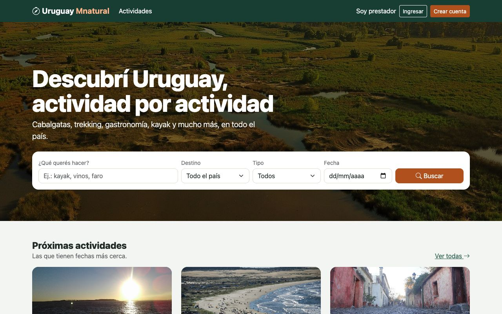

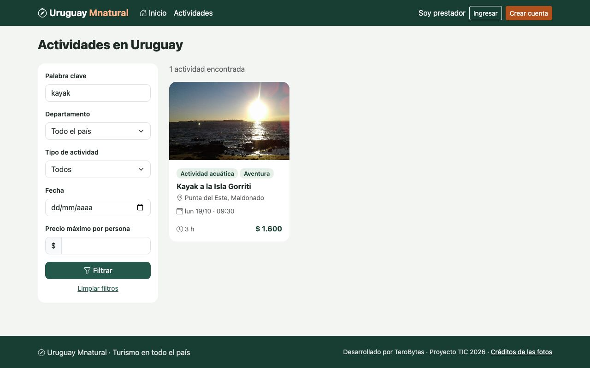

### Ver una actividad

1. Tocá cualquier actividad de la lista, por ejemplo *Cabalgata al atardecer por las dunas*.
2. Ahí está todo: descripción, duración, edad mínima, cancelación, el equipamiento (qué da el prestador y qué hay que llevar) y las opiniones con estrellas.
3. A la derecha están las **Próximas fechas**, con el pronóstico del clima de cada día.
4. Para reservar, tocá **Reservar** en una fecha. Si no ingresaste, te pide la cuenta y después te devuelve a la reserva.

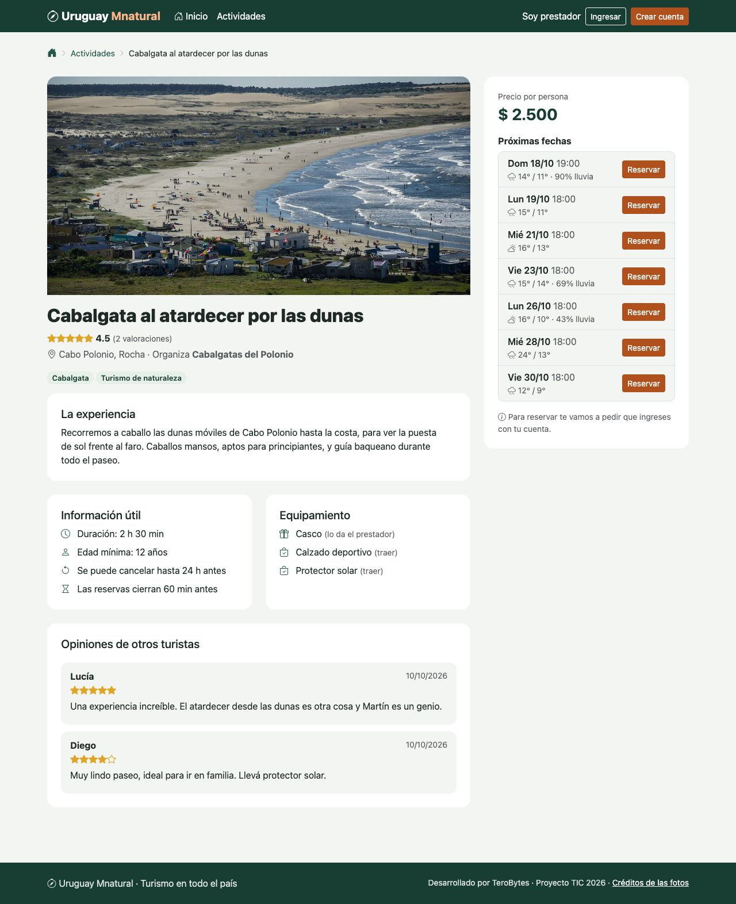

### Crear una cuenta o ingresar

1. Para ser turista: **Crear cuenta**, arriba a la derecha. Pide nombre, apellido, documento, fecha de nacimiento, email y contraseña.
2. Para ofrecer actividades: **Soy prestador**. Se cargan los datos del prestador (empresa o particular) y los del emprendimiento, que queda *pendiente* hasta que lo aprueba el administrador.
3. Si ya tenés cuenta: **Ingresar**, con el email y la contraseña.

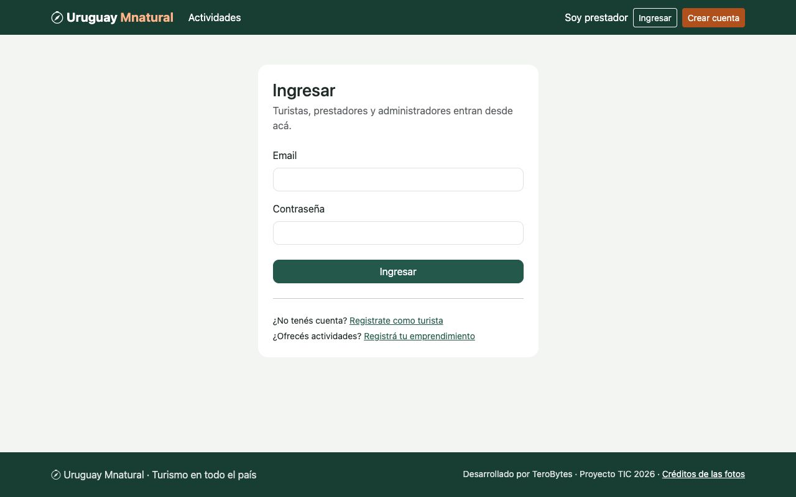

---

## Turista: reservar, pagar y valorar

Con `turista@demo.uy`. Arriba aparece **Mis reservas**, donde el turista ve todo lo que reservó.

### Reservar una actividad

1. En el detalle de una actividad, tocá **Reservar** en la fecha que quieras.
2. Poné cuántas personas van y completá nombre, apellido, documento y edad de cada una. La primera fila viene con tus datos: cambialos si no vas vos. Si alguien no llega a la edad mínima de la actividad, no deja reservar. El total se calcula solo.
3. Si hace falta, escribí una observación para el prestador (por ejemplo, "Una persona es celíaca").
4. Tocá **Continuar al pago**. El lugar queda guardado 2 horas mientras pagás.

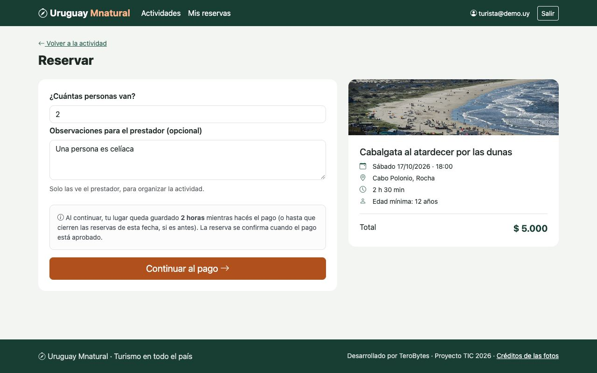

### Pagar

1. Escribí el número de una de las [tarjetas de prueba](#tarjetas-de-prueba).
2. Tocá **Pagar**.
3. Si el pago se rechaza, aparece el aviso en rojo y podés intentar con otra tarjeta. La reserva no se confirma hasta que un pago se aprueba.

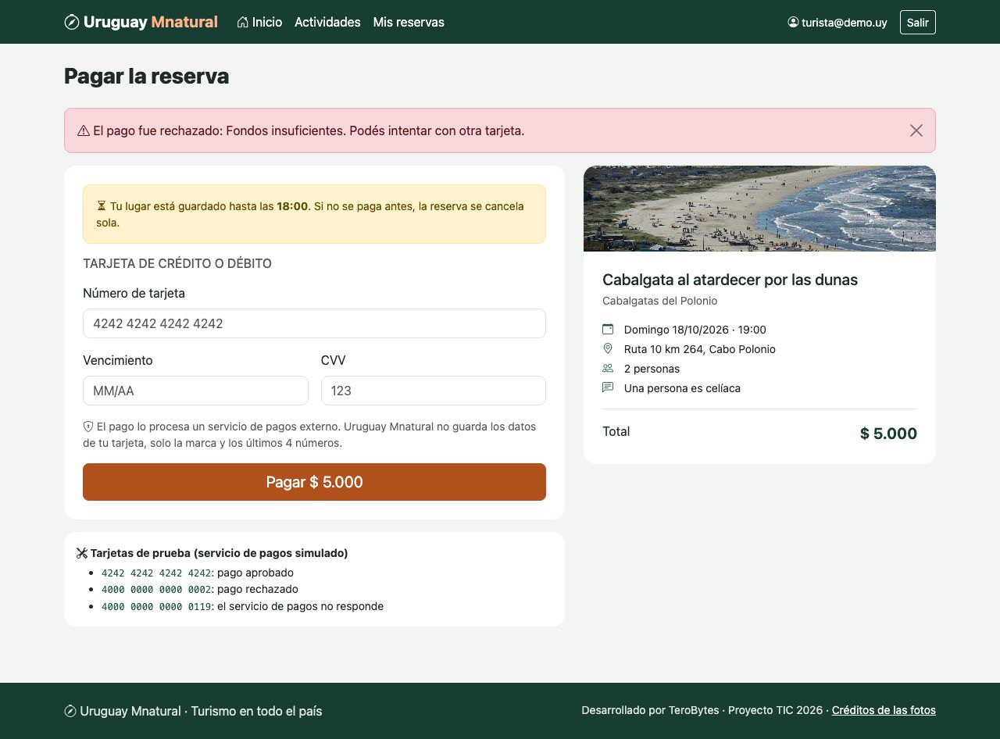

### La entrada con QR

Cuando el pago se aprueba, la reserva queda **Confirmada** y aparece la entrada con su código QR y su número (por ejemplo `UM-PJA9SQ`). Abajo se ve el historial de todos los intentos de pago.

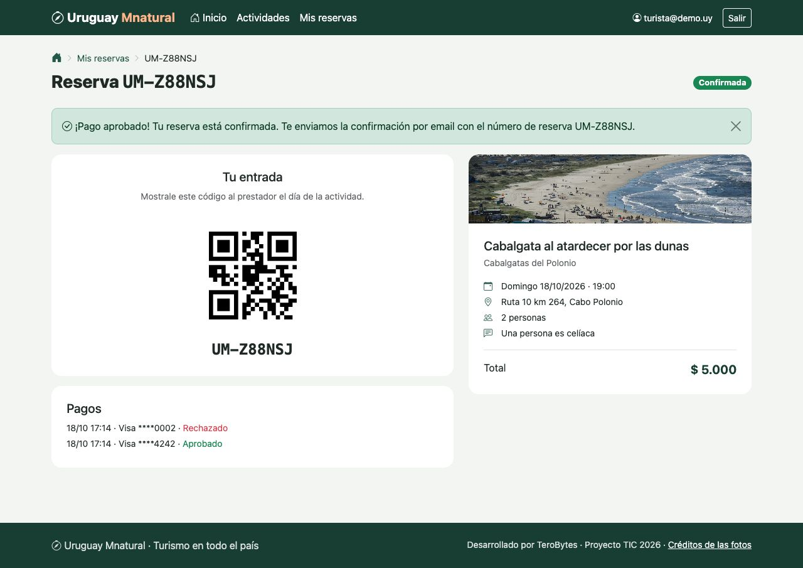

### Ver mis reservas y cancelar una

1. Tocá **Mis reservas** en el menú de arriba.
2. Cada reserva muestra su estado: *Confirmada*, *Pendiente de pago* (con el botón **Pagar**) o *Realizada*.
3. Para cancelar, entrá a **Ver detalle** y tocá **Cancelar reserva**. El botón aparece solo si falta más tiempo que el plazo de la actividad (en la cabalgata, 24 horas). Probalo con `UM-PROX7A`.
4. Arriba del botón dice cuánto se te devuelve: el porcentaje que fijó el prestador (en la cabalgata, el 50 %). Al cancelar, la plata vuelve a la tarjeta y en el detalle queda el **Reembolso** con el monto. Si el servicio de pagos no responde, queda *en trámite* y se reintenta solo cada 5 minutos.

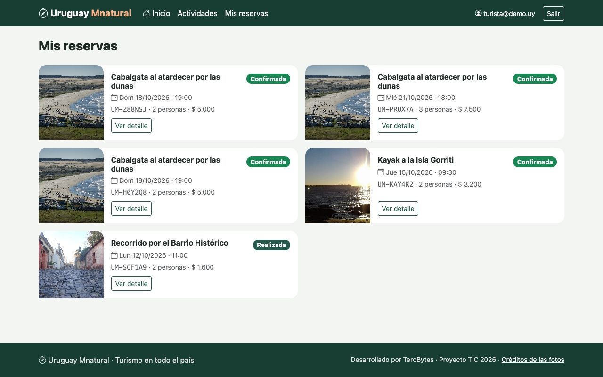

### Valorar una actividad

1. En **Mis reservas**, entrá a una actividad que ya pasó. En los datos de prueba es `UM-KAY4K2` (Kayak a la Isla Gorriti).
2. Elegí de 1 a 5 estrellas y escribí un comentario.
3. Tocá **Enviar valoración**. La opinión aparece en el detalle de la actividad.

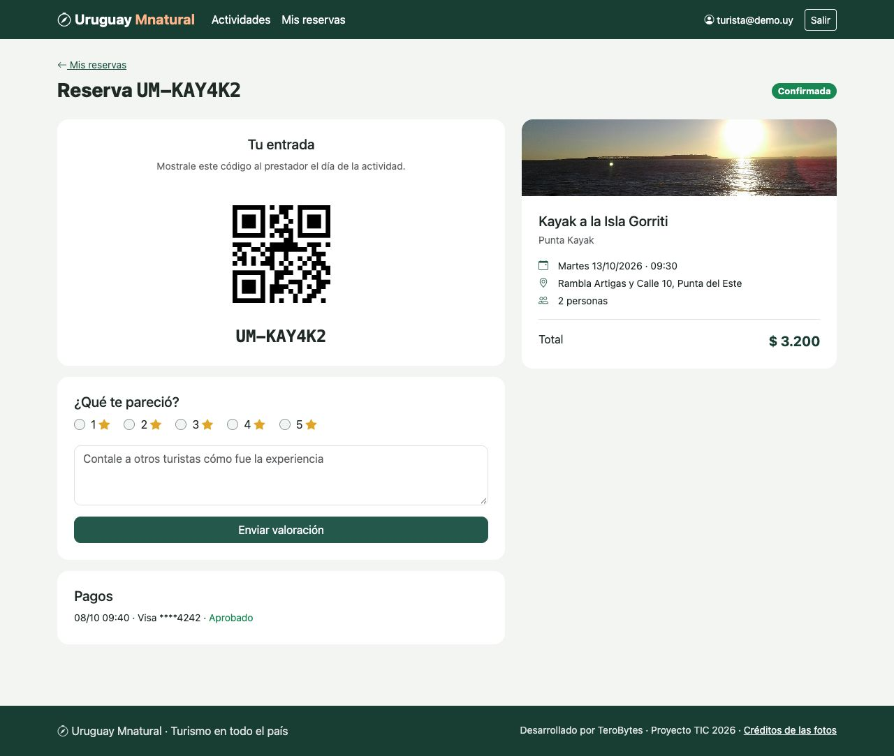

---

## Prestador: gestionar el emprendimiento

Con `prestador@demo.uy`. Arriba aparecen **Mi emprendimiento** y **Reservas**.

### Su panel

Al ingresar se ve el emprendimiento con su estado (*Aprobado*) y la lista de sus actividades, con el precio, cuántas fechas tiene y si está publicada. **Gestionar** abre cada actividad.

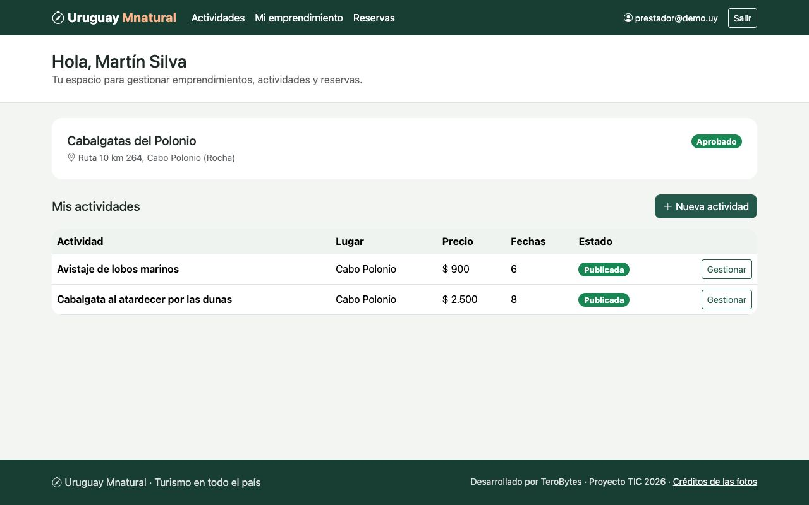

### Crear una actividad

1. En el panel, tocá **+ Nueva actividad**.
2. Completá el nombre, la descripción, dónde se realiza, la duración en minutos, el precio por persona y la edad mínima (opcional).
3. Marcá el tipo de actividad (por ejemplo Senderismo) y el equipamiento: qué da el prestador y qué tiene que traer el turista.
4. Elegí cuándo cierran las reservas, si el turista puede cancelar, con cuánta anticipación y qué porcentaje se le devuelve si cancela, y si la actividad queda visible en el portal.
5. Guardá. Después hay que agregarle fechas (paso siguiente).

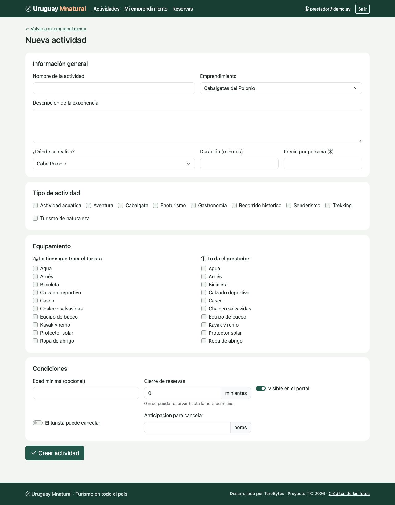

### Agregar o cancelar fechas

1. Entrá a una actividad con **Gestionar**.
2. A la izquierda, elegí día y hora en **Inicio**. El cupo es opcional: vacío quiere decir sin cupo.
3. Tocá **Agregar**. La fecha aparece en la lista y en el portal.
4. Para cancelar una fecha, elegí el motivo y tocá **Cancelar fecha**. Sus reservas se cancelan solas y a los turistas que ya pagaron se les devuelve el 100 %. En **Reservas** se ve cuánto se devolvió en cada una.

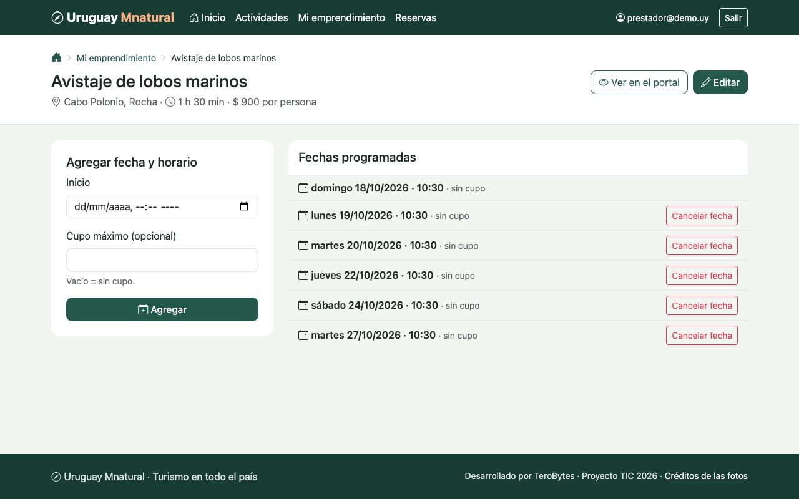

### Ver las reservas y registrar asistencia

1. Tocá **Reservas** en el menú de arriba. Aparecen todas las reservas de sus actividades, con las observaciones de cada turista.
2. El día de la actividad, escribí el número de la reserva en **Registrar asistencia** (en la demo, `UM-H0Y2Q8`) y tocá **Registrar**. Es lo mismo que escanear el QR.
3. La reserva pasa a *Realizada*.

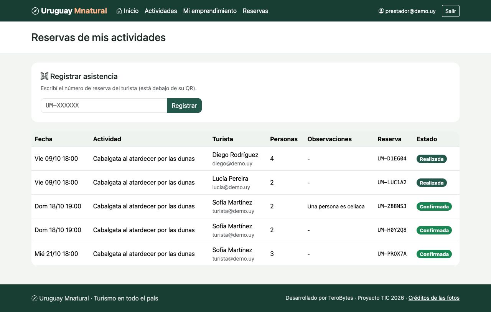

> La asistencia solo se registra **el día** de la actividad. Por eso los datos de prueba se reinician la mañana de la demo (ver [Si algo falla](#si-algo-falla)).

### Un emprendimiento pendiente

Con `pendiente@demo.uy` se ve cómo queda un prestador recién registrado: el aviso de que está en evaluación y sin poder cargar actividades. Si el administrador lo rechaza, acá aparece el motivo.

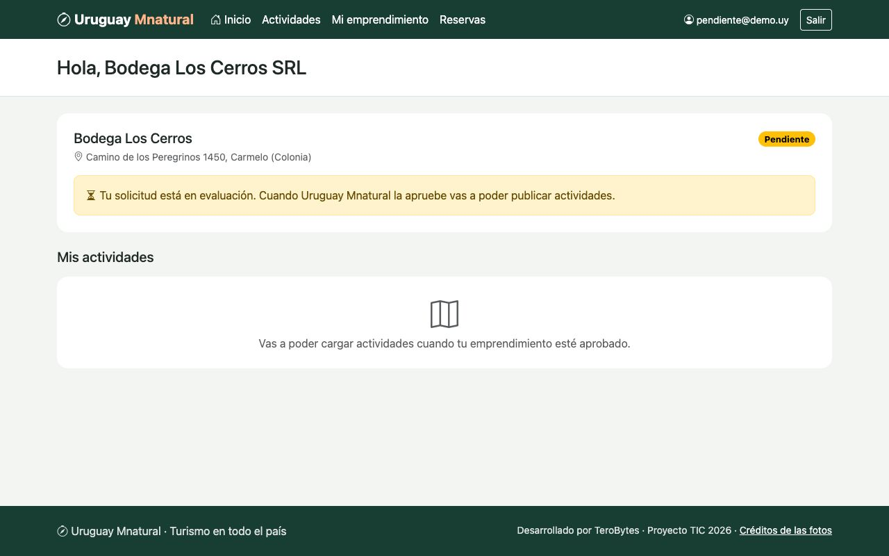

---

## Administrador: administrar el portal

Con `admin@uymnatural.uy`. Arriba aparece **Administración**, con cuatro pestañas: Solicitudes, Emprendimientos, Tipos de actividad y Equipamiento.

### Aprobar o rechazar un emprendimiento

1. En **Solicitudes** están los emprendimientos que esperan respuesta, con los datos del prestador.
2. Tocá **Aprobar** para que pueda publicar actividades.
3. O tocá **Rechazar** y escribí el motivo. El prestador lo ve en su panel.
4. En **Emprendimientos** se ven todos, con su estado.

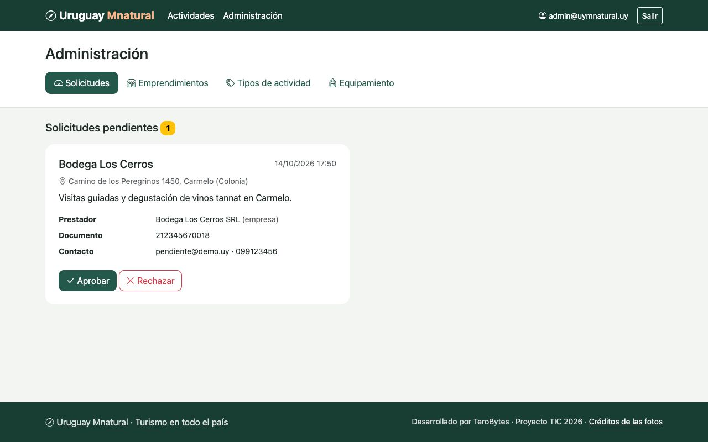

### Tipos de actividad y equipamiento

1. Entrá a **Tipos de actividad** (o **Equipamiento**, que funciona igual).
2. Para agregar: escribí el nombre a la izquierda y tocá **+ Agregar**.
3. Para modificar: cambiá el texto en la lista y tocá el botón verde ✓.
4. Para eliminar: el botón rojo. Si alguna actividad usa ese tipo, el sistema no deja borrarlo y avisa.

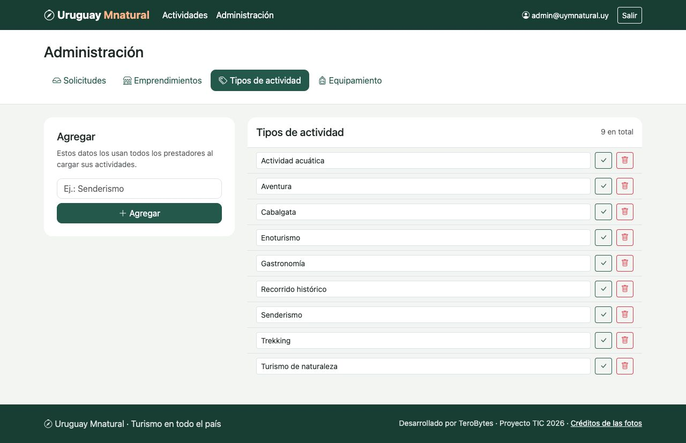

---

## Parte técnica

### La API pública

1. Entrá a http://localhost:8080/swagger-ui.html.
2. Abrí, por ejemplo, "Top 3 del mes por departamento" o "Buscar actividades por palabra clave".
3. Tocá **Try it out** y después **Execute**. Abajo aparece la respuesta.

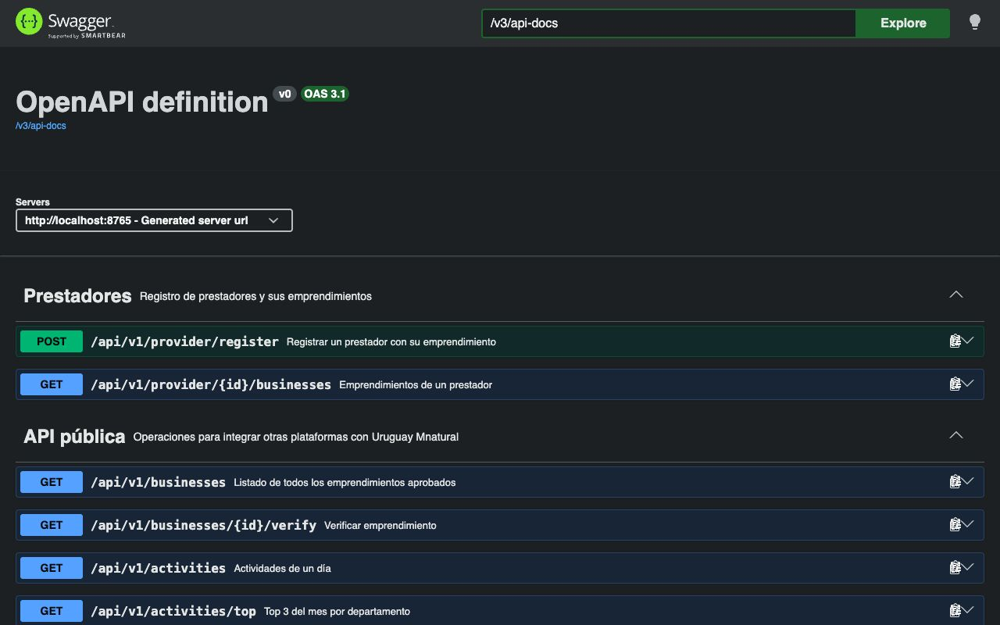

### Las pruebas y el celular

Las pruebas se corren con `./mvnw test`: son 114 y pasan todas. La app también se adapta al celular.

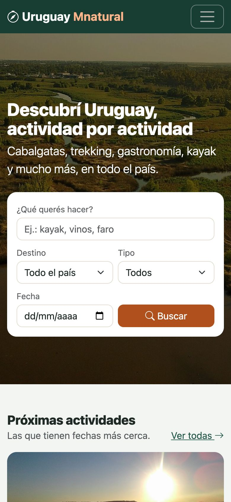

---

## Si algo falla

- **"La asistencia se registra el día de la actividad":** los datos de prueba se cargaron otro día. La mañana de la demo se reinician una vez, como explica "Antes de empezar" en [`GUION_DEMO.md`](GUION_DEMO.md).
- **La app no arranca o no conecta:** fijarse en el panel de Supabase que el proyecto esté activo. Se pausa solo después de una semana sin uso.
- **No aparece el clima en las fechas:** el pronóstico necesita internet. Sin internet, todo lo demás funciona igual.
- **Quiero mostrar dos usuarios a la vez:** abrí una ventana normal y otra de incógnito. Cada una puede tener una cuenta distinta.
