# Uruguay Mnatural — Manual del administrador

Este manual es para el equipo de Uruguay Mnatural que administra la plataforma. Te explica cómo revisar las solicitudes de los emprendimientos nuevos (aprobarlas o rechazarlas), consultar todos los emprendimientos y mantener las listas de **tipos de actividad** y de **equipamiento** que usan los prestadores.

**Lo que vas a poder hacer:**

1. Ingresar al panel de administración.
2. Revisar la bandeja de solicitudes: aprobar o rechazar emprendimientos.
3. Ver todos los emprendimientos y su estado.
4. Agregar, modificar y eliminar tipos de actividad.
5. Agregar, modificar y eliminar equipamiento.

> La cuenta de administrador la entrega el equipo de Uruguay Mnatural. No se crea desde el portal.

---

## 1. Ingresar

1. Entrá a la página de Uruguay Mnatural y tocá **Ingresar**, arriba a la derecha.
2. Escribí tu **email** y tu **contraseña** de administrador y tocá **Ingresar**.

   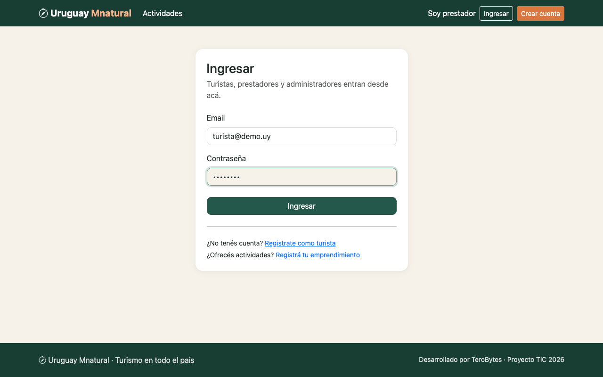

3. Entrás directo a **Administración**. Arriba ves el menú con cuatro secciones: **Solicitudes**, **Emprendimientos**, **Tipos de actividad** y **Equipamiento**.

---

## 2. Bandeja de solicitudes

Cada vez que un prestador registra su emprendimiento, la solicitud llega acá. **Hasta que la apruebes, el prestador no puede publicar actividades.**

1. Tocá **Solicitudes**. El número al lado de **Solicitudes pendientes** indica cuántas hay por resolver.
2. Cada solicitud es una tarjeta con:
   - El **nombre del emprendimiento** y la fecha en que se pidió.
   - La **dirección** y la localidad.
   - La **descripción** de sus servicios.
   - Los datos del **prestador**: nombre, si es empresa o particular, **documento** y **contacto** (email y teléfono).

   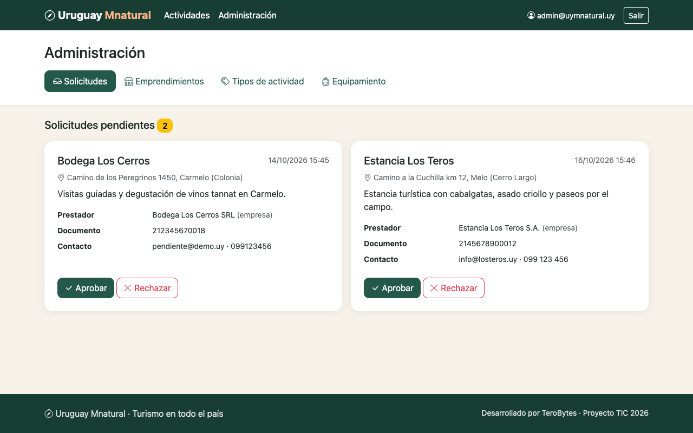

3. Revisá los datos y decidí.

### 2.1 Aprobar una solicitud

1. En la tarjeta del emprendimiento, tocá **Aprobar**.

   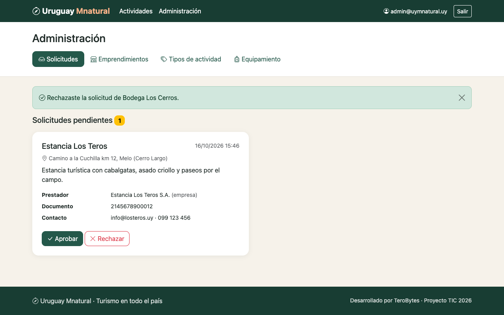

2. El sistema confirma con *"Aprobaste [emprendimiento]. Ya puede publicar actividades."* y la solicitud sale de la bandeja.

   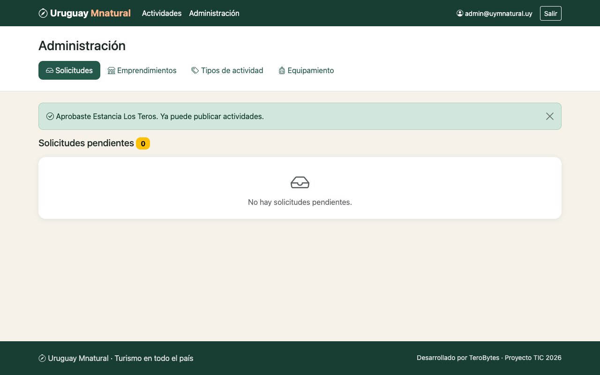

3. El prestador ve su emprendimiento como **Aprobado** y ya puede crear actividades.

### 2.2 Rechazar una solicitud

1. En la tarjeta del emprendimiento, tocá **Rechazar**. Se abre un cuadro **Motivo del rechazo (lo ve el prestador)**.
2. Escribí el motivo. **Es obligatorio**: sin motivo, el sistema no deja rechazar.

   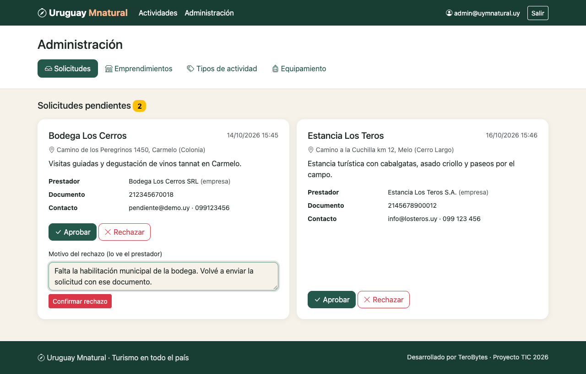

3. Tocá **Confirmar rechazo**.
4. El sistema confirma con *"Rechazaste la solicitud de [emprendimiento]."*

   

5. El prestador ve en su panel que fue **rechazado** y lee el motivo que escribiste.

**Tené en cuenta:** una solicitud que ya fue aprobada o rechazada no se puede resolver de nuevo.

Cuando no quedan solicitudes por resolver, la bandeja muestra *"No hay solicitudes pendientes."*

---

## 3. Ver todos los emprendimientos

1. Tocá **Emprendimientos**.
2. Ves una tabla con todos los emprendimientos de la plataforma:
   - **Emprendimiento**
   - **Prestador**
   - **Ubicación**
   - **Solicitud**: la fecha en que se pidió.
   - **Estado**: **Pendiente**, **Aprobado** o **Rechazado**. En los rechazados se muestra también el motivo.

   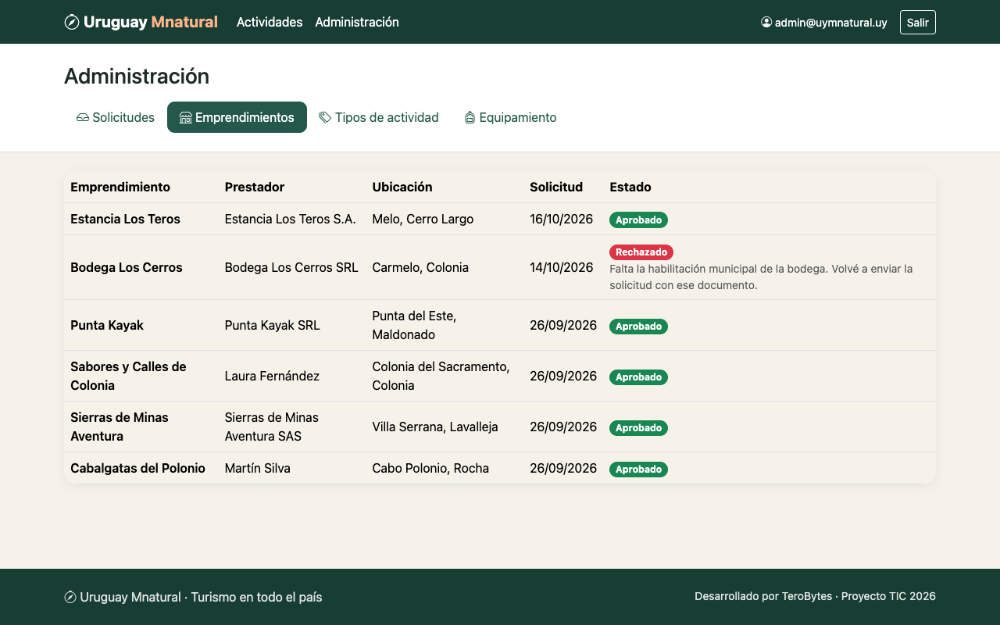

---

## 4. Tipos de actividad

Son las categorías que los prestadores eligen al crear una actividad (por ejemplo, Cabalgata, Trekking, Gastronomía). También las usan los turistas para filtrar sus búsquedas.

1. Tocá **Tipos de actividad**. A la izquierda está el cuadro para agregar y a la derecha la lista completa, con el total.

   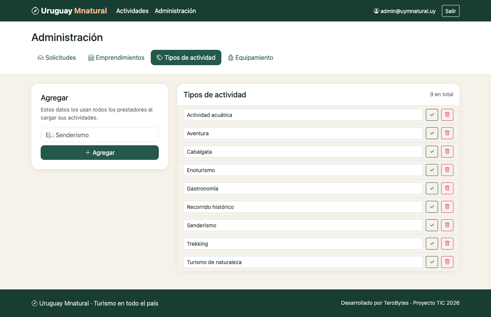

### 4.1 Agregar un tipo

1. En **Agregar**, escribí el nombre del nuevo tipo (por ejemplo, *Observación de aves*).

   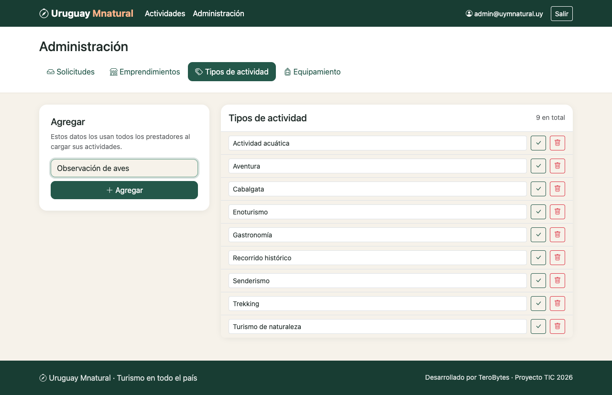

2. Tocá **Agregar**. El sistema muestra *"Tipo de actividad agregado."* y el tipo aparece en la lista.

   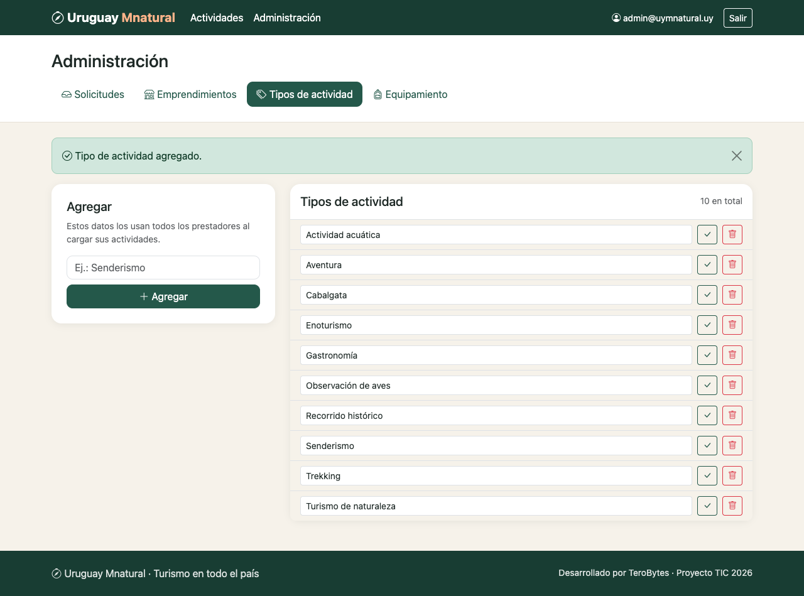

El nombre es obligatorio y no puede repetirse: si ya existe un tipo con ese nombre, el sistema te avisa.

### 4.2 Modificar un tipo

1. En la lista, hacé clic sobre el nombre y escribí el nuevo.
2. Tocá el botón con la tilde (✓) de esa fila (**Guardar**).
3. El sistema muestra *"Tipo de actividad modificado."*

   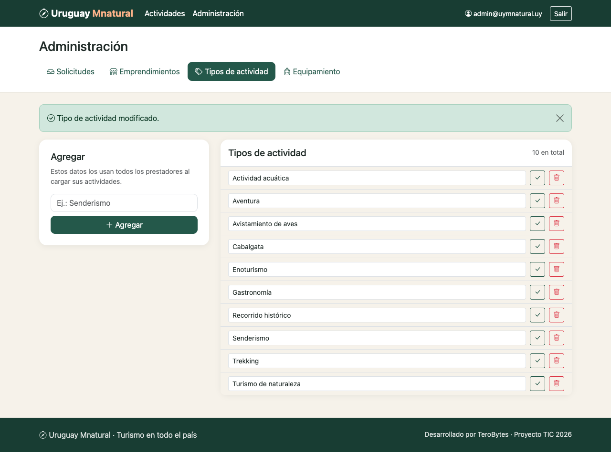

### 4.3 Eliminar un tipo

1. En la fila del tipo, tocá el botón del tachito (**Eliminar**).
2. El sistema pregunta *"¿Eliminar este elemento?"*. Aceptá.
3. Si el tipo no lo usa ninguna actividad, se elimina: *"Tipo de actividad eliminado."*

   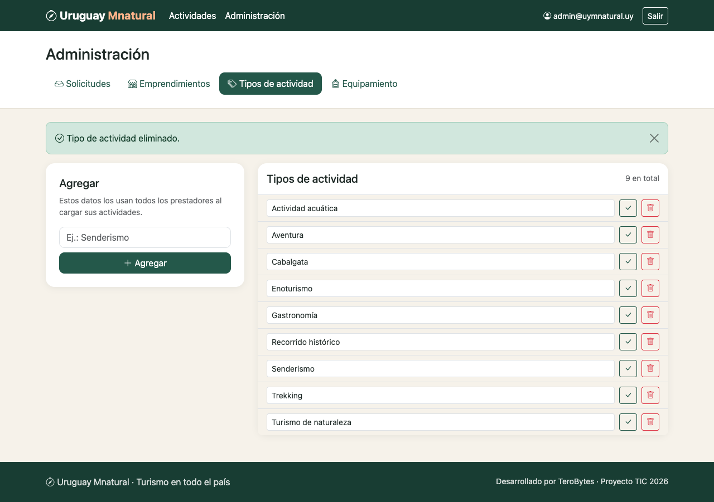

**Si lo usa alguna actividad, no se puede eliminar.** El sistema te avisa *"No se puede eliminar: hay actividades con ese tipo"* y no borra nada. Así ninguna actividad queda sin su tipo.

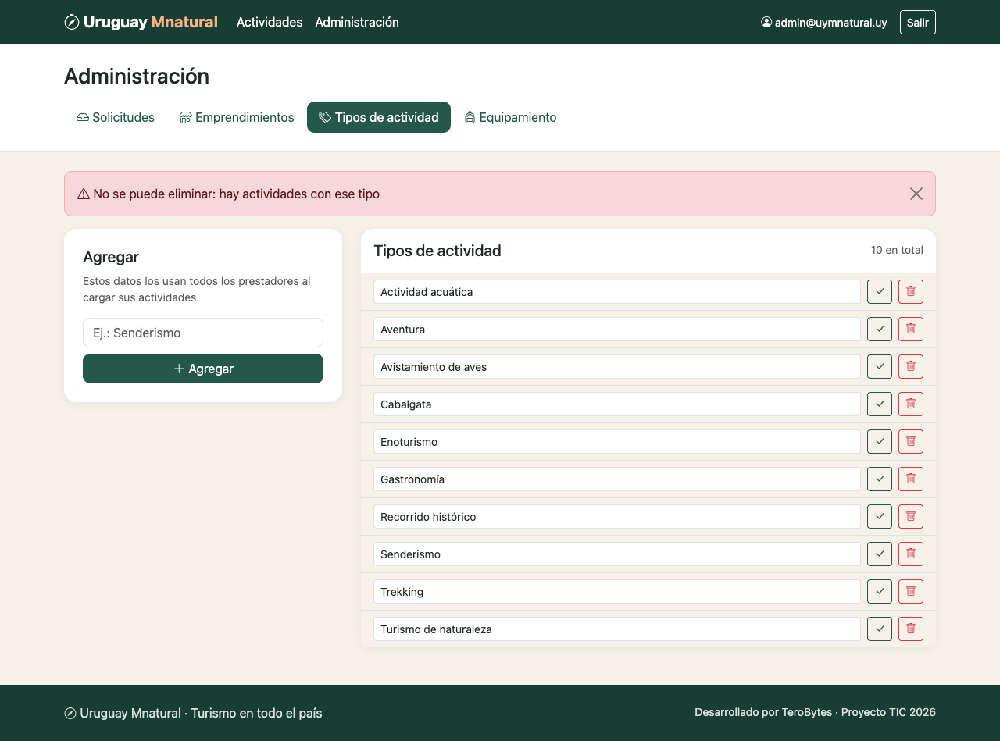

---

## 5. Equipamiento

Es la lista de elementos que los prestadores marcan al crear una actividad, ya sea porque los da el prestador o porque tiene que llevarlos el turista (por ejemplo, Casco, Protector solar, Kayak y remo). Funciona igual que los tipos de actividad.

1. Tocá **Equipamiento**.

   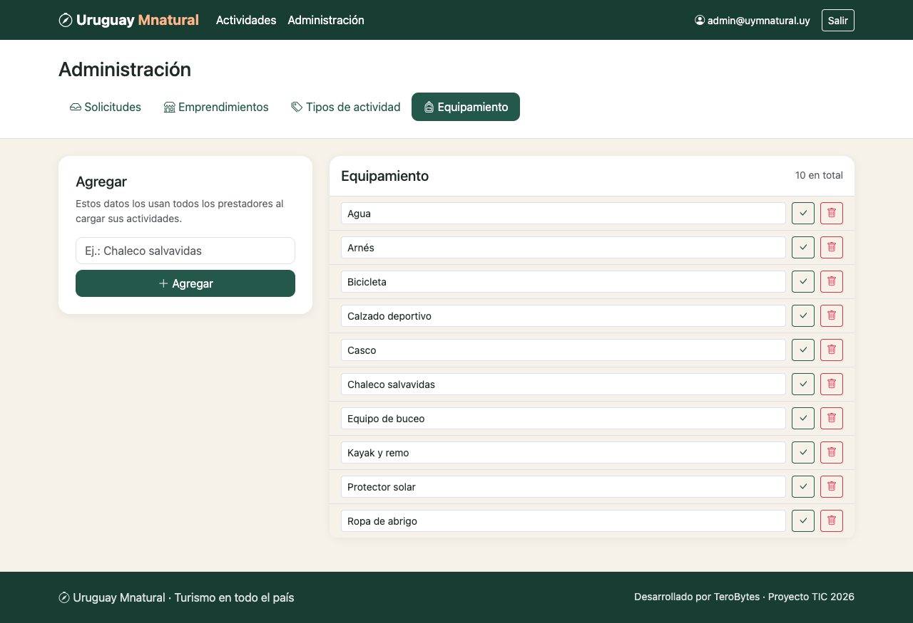

2. **Agregar:** escribí el nombre (por ejemplo, *Binoculares*) y tocá **Agregar**. El sistema muestra *"Equipamiento agregado."*

   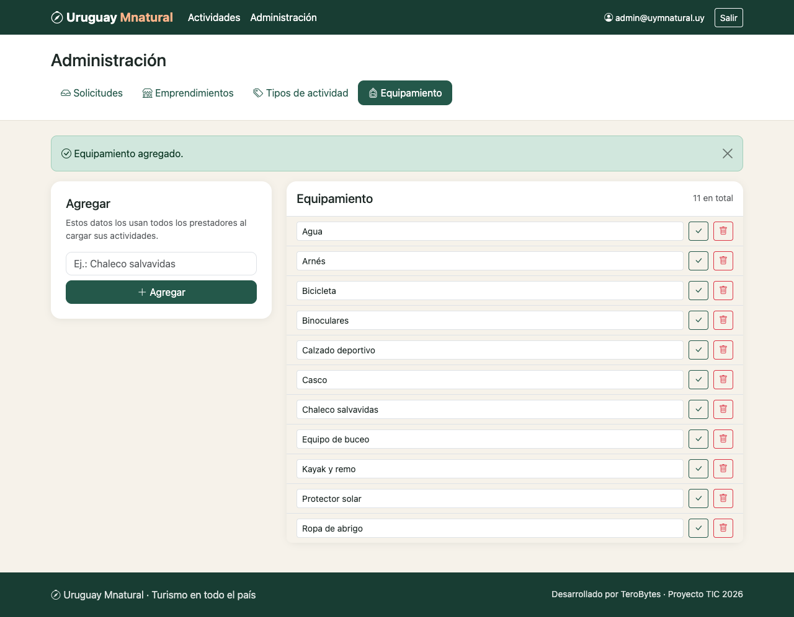

3. **Modificar:** cambiá el nombre en su fila y tocá la tilde (✓).
4. **Eliminar:** tocá el tachito y aceptá la pregunta. Si alguna actividad usa ese equipamiento, el sistema avisa *"No se puede eliminar: hay actividades que usan ese equipamiento"* y no lo borra.

El nombre es obligatorio y no puede repetirse.

---

## 6. Salir

Tocá **Salir**, arriba a la derecha, cuando termines.

---

## Preguntas frecuentes

**Un prestador dice que no puede cargar actividades.**
Revisá en **Emprendimientos** el estado de su solicitud. Si está **Pendiente**, tenés que aprobarla desde **Solicitudes**.

**Rechacé una solicitud sin querer, ¿puedo deshacerlo?**
No: una solicitud resuelta no se puede volver a resolver desde el panel. Por eso, antes de tocar **Confirmar rechazo**, revisá bien los datos.

**¿Qué ve el prestador cuando rechazo su solicitud?**
Ve que su emprendimiento fue **rechazado** y el texto que escribiste en el motivo. Por eso conviene que sea claro.

**Quiero borrar un tipo de actividad y no me deja.**
Es porque hay actividades que lo usan. Si el nombre está mal escrito, mejor **modificarlo**: el cambio se aplica a todas las actividades que lo usan.
