# Uruguay Mnatural — Manual del prestador

Este manual es para quienes ofrecen actividades turísticas: empresas o personas particulares con un emprendimiento. Te explica cómo registrarte, publicar tus actividades, agregar fechas, ver las reservas que te hacen los turistas y registrar la asistencia el día de la actividad.

**Lo que vas a poder hacer:**

1. Registrar tu emprendimiento y esperar su aprobación.
2. Ingresar a tu espacio de gestión.
3. Crear una actividad.
4. Agregarle fechas y horarios, y cancelarlas si hace falta.
5. Editar una actividad.
6. Ver las reservas de tus actividades.
7. Registrar la asistencia de los turistas.

---

## 1. Registrar tu emprendimiento

1. Entrá a la página de Uruguay Mnatural. Arriba a la derecha tocá **Soy prestador** (o, en la portada, **Registrar emprendimiento**).
2. Completá el formulario en dos partes:

   **Tus datos**
   - **¿Sos empresa o persona particular?**
   - **Nombre o razón social**
   - **Documento o RUT**
   - **Teléfono**
   - **Email (para ingresar)**
   - **Contraseña**: al menos 8 caracteres.

   **Tu emprendimiento**
   - **Nombre del emprendimiento**
   - **Localidad**
   - **Dirección**
   - **Teléfono** y **Email de contacto**
   - **Descripción de los servicios**

   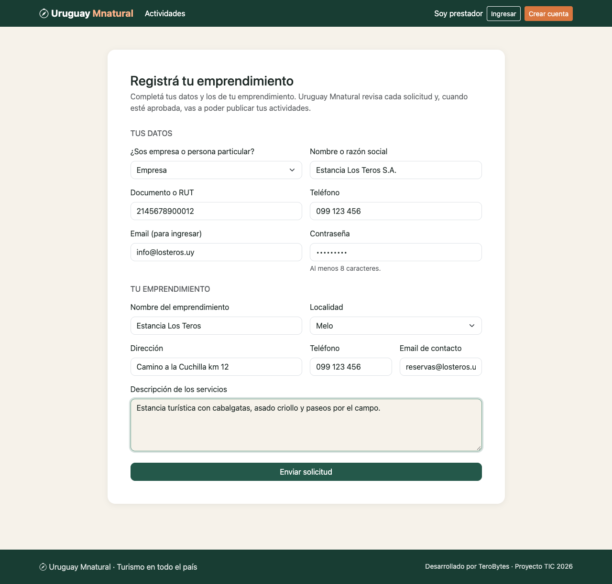

3. Tocá **Enviar solicitud**.
4. Vas a ver el mensaje *"Recibimos tu solicitud. Un administrador la va a revisar; mientras tanto ya podés ingresar."*

   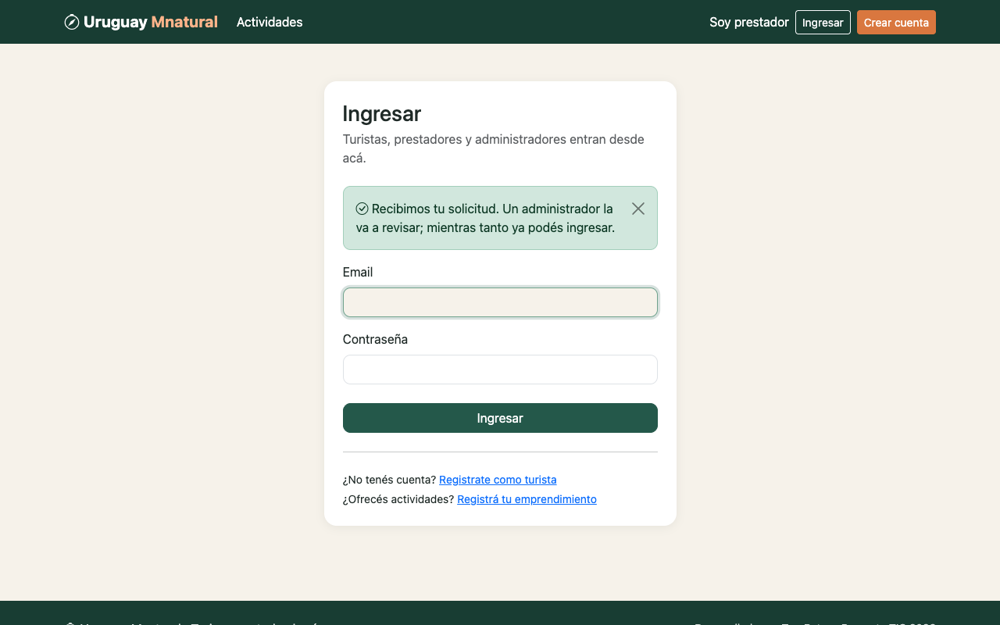

**Si algo sale mal:** si el email o el documento ya están registrados, o falta algún dato obligatorio, el sistema te lo avisa y no envía la solicitud.

---

## 2. Ingresar a tu espacio

1. Tocá **Ingresar** arriba a la derecha.
2. Escribí el **email** y la **contraseña** que usaste al registrarte y tocá **Ingresar**.

   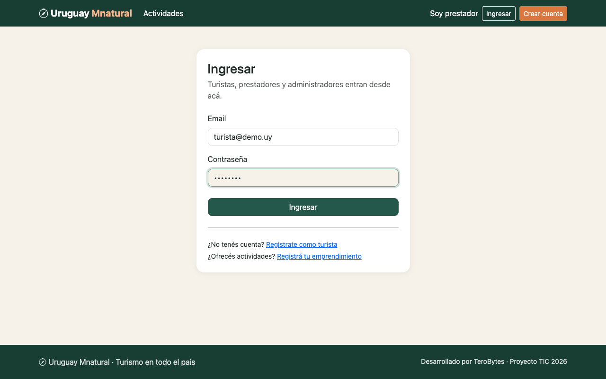

3. Entrás a tu panel (**Mi emprendimiento**). Arriba tenés el menú **Mi emprendimiento** y **Reservas**.

### Estados de tu solicitud

Mientras un administrador revisa tu solicitud, tu emprendimiento aparece como **Pendiente** y **todavía no podés publicar actividades**.

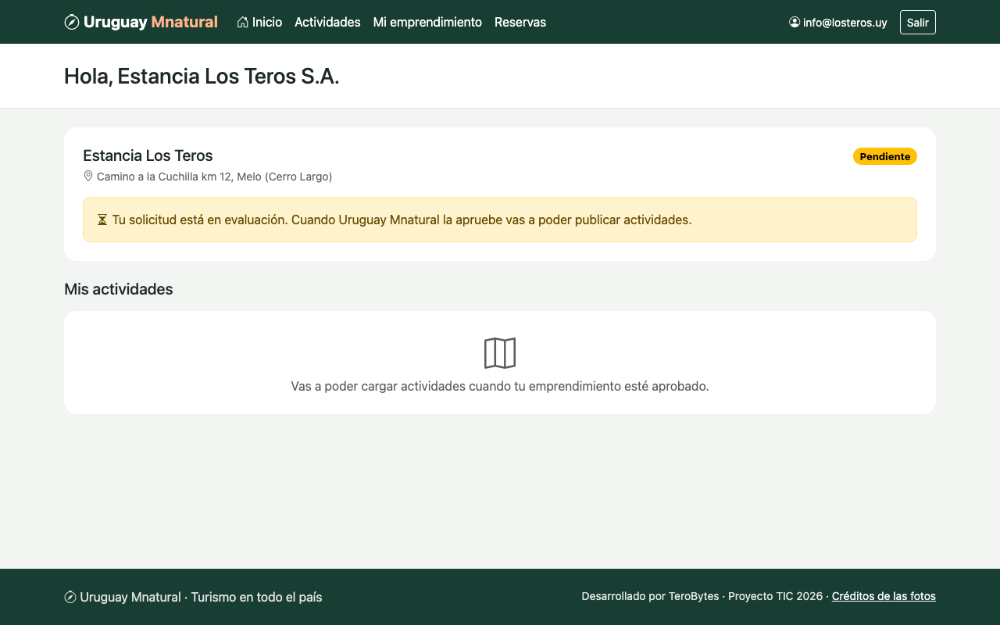

Cuando el administrador la resuelve, pasa a uno de estos estados:

- **Aprobado**: ya podés crear actividades y recibir reservas.

  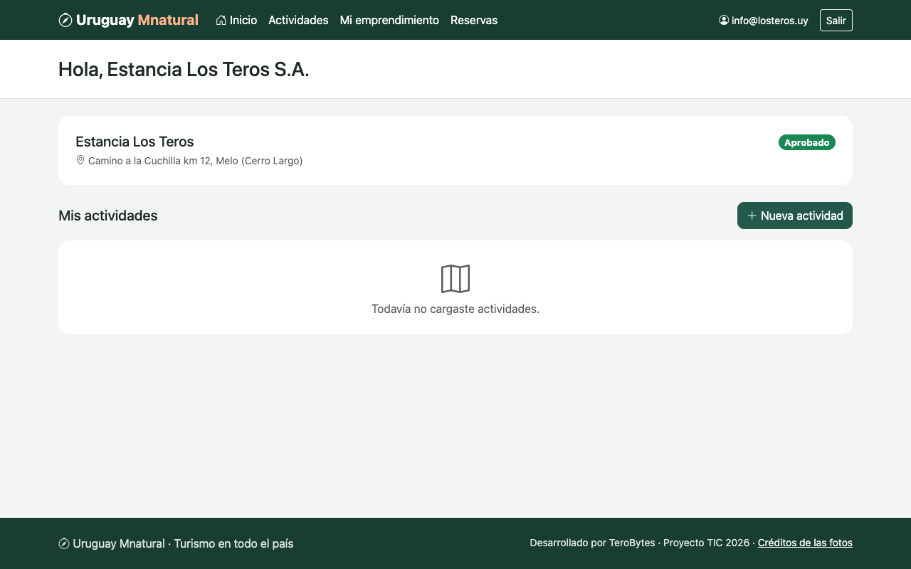

- **Rechazado**: en tu panel aparece el **motivo** que escribió el administrador. Con ese dato sabés qué faltó. Para volver a presentarte, consultá con Uruguay Mnatural.

  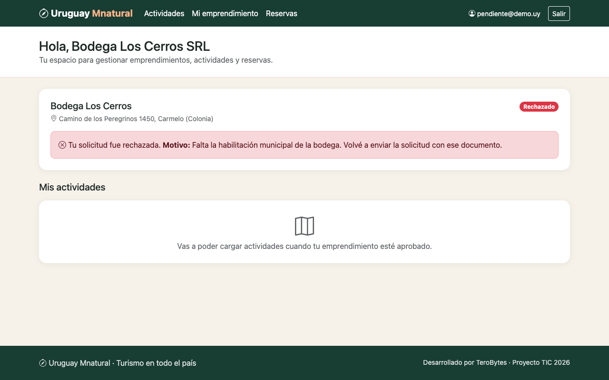

---

## 3. Tu panel: "Mi emprendimiento"

Cuando tu emprendimiento está aprobado, el panel muestra:

- Los datos del emprendimiento y su estado.
- **Mis actividades**: una tabla con cada actividad, su lugar, el precio por persona, cuántas fechas tiene y si está **Publicada** u **Oculta**.
- El botón **Nueva actividad** y, en cada fila, el botón **Gestionar**.

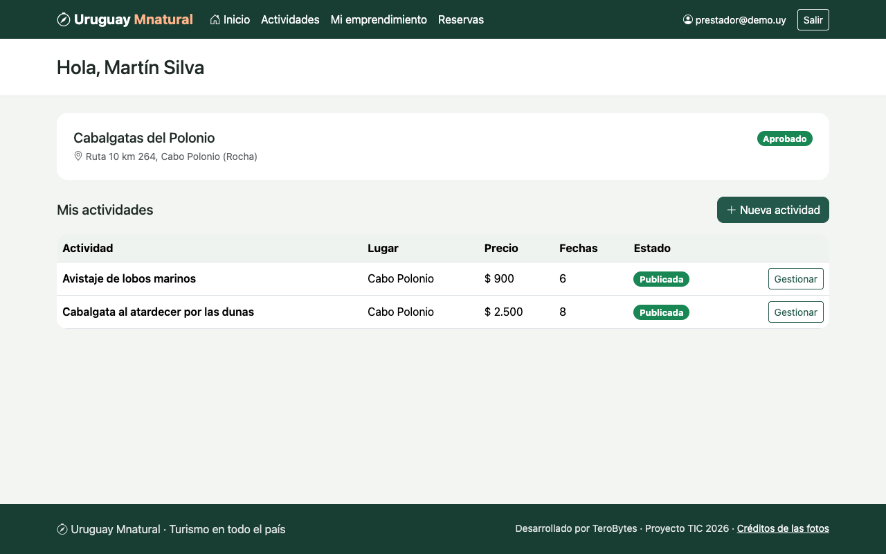

---

## 4. Crear una actividad

1. En tu panel tocá **Nueva actividad**.

   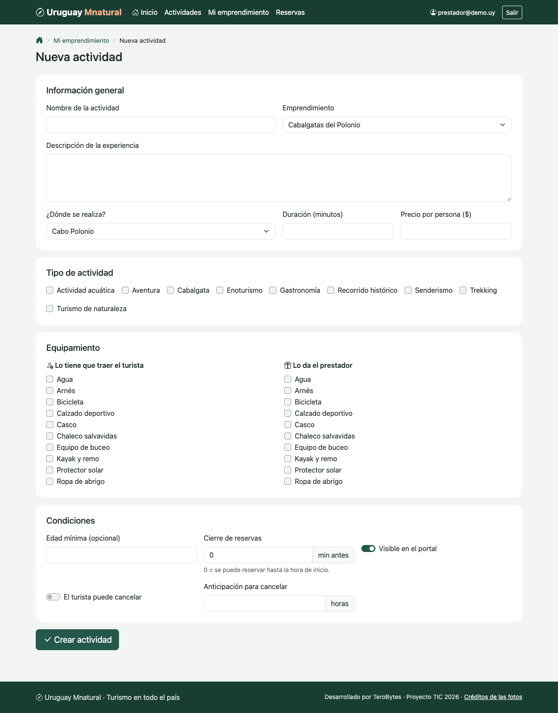

2. Completá el formulario:

   **Información general**
   - **Nombre de la actividad**.
   - **Emprendimiento** (si tenés más de uno, elegí cuál).
   - **Descripción de la experiencia**: contale al turista de qué se trata.
   - **¿Dónde se realiza?**: la localidad.
   - **Duración (minutos)**.
   - **Precio por persona ($)**.
   - **Tipo de actividad**: marcá uno o más (por ejemplo, Senderismo y Turismo de naturaleza). **Hay que elegir al menos uno.**

   **Equipamiento**
   - **Lo tiene que traer el turista**: marcá lo que el turista debe llevar.
   - **Lo da el prestador**: marcá lo que ponés vos.

   **Condiciones**
   - **Edad mínima** (opcional).
   - **Cierre de reservas**: cuántos minutos antes del inicio se dejan de aceptar reservas. Con **0** se puede reservar hasta la hora de inicio.
   - **Visible en el portal**: si lo dejás activado, los turistas ven la actividad. Si lo desactivás, queda **Oculta**.
   - **El turista puede cancelar**: si lo activás, indicá la **anticipación para cancelar** en horas (por ejemplo, 24 horas antes).

   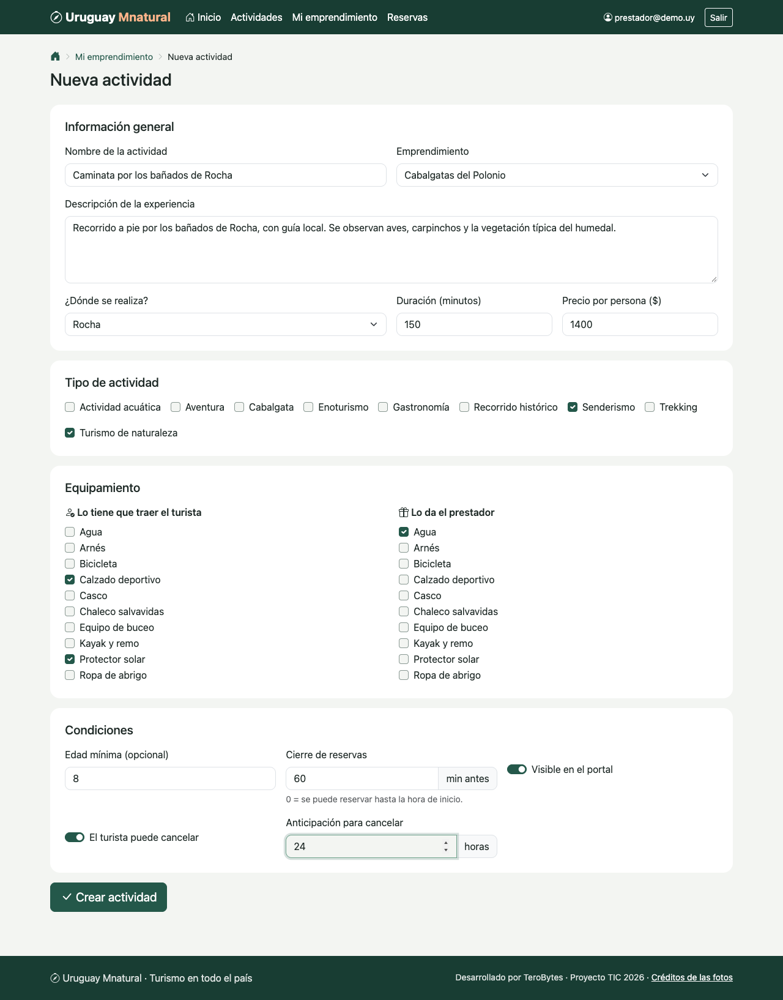

3. Tocá **Crear actividad**.
4. El sistema muestra *"Actividad creada. Ahora agregale fechas y horarios."* y te lleva a la pantalla de la actividad.

   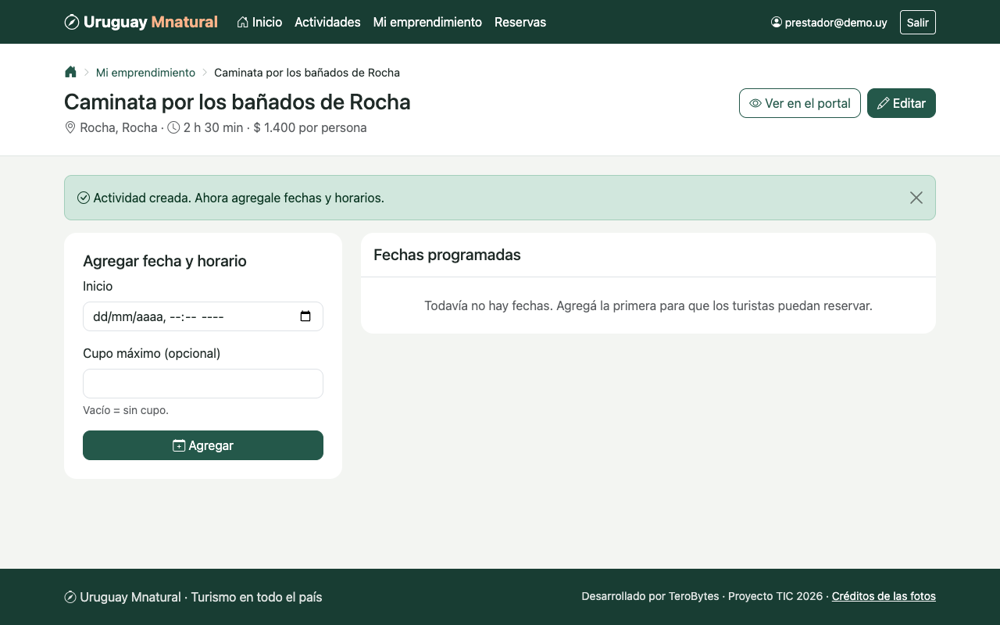

**Datos que el sistema controla:** que no falten datos obligatorios, que la duración sea mayor a cero, que el precio y la edad mínima no sean negativos, y que elijas al menos un tipo de actividad.

> **Una actividad sin fechas no se puede reservar.** El siguiente paso es agregarle fechas.

---

## 5. Agregar fechas y horarios

1. Entrá a la actividad: desde tu panel, tocá **Gestionar** en su fila.
2. En **Agregar fecha y horario**, completá:
   - **Inicio**: día y hora.
   - **Cupo máximo** (opcional): cuántas personas como máximo. **Si lo dejás vacío, no hay límite.**

   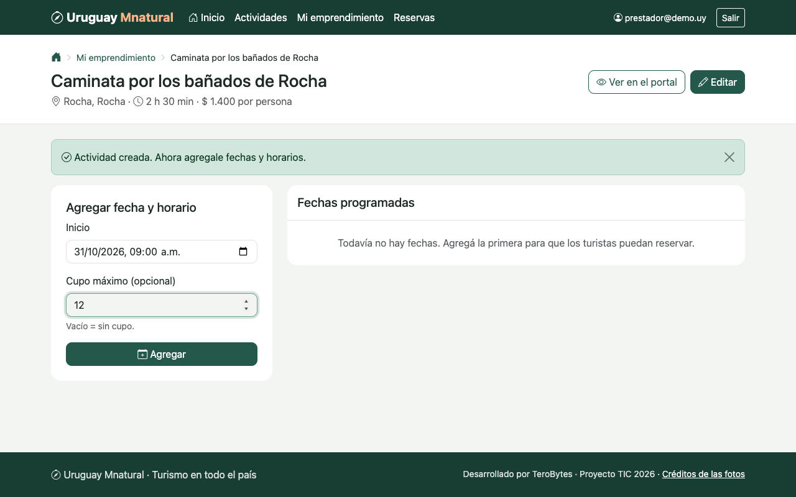

3. Tocá **Agregar**. La fecha aparece en **Fechas programadas** y ya la ven los turistas.
4. Repetí los pasos para cada fecha que quieras ofrecer.

   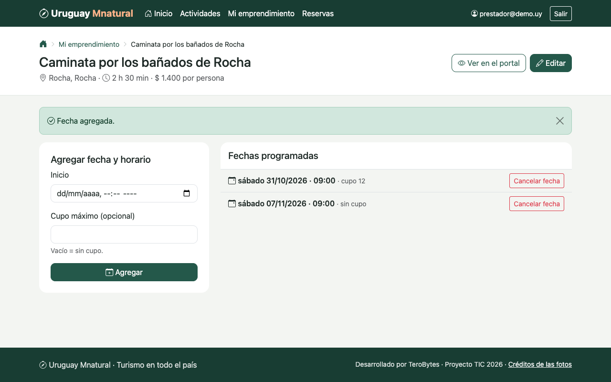

**Tené en cuenta:** la fecha tiene que ser futura y el cupo, de al menos 1 persona.

### Cancelar una fecha

Si no podés hacer la actividad un día (por ejemplo, por mal tiempo):

1. En la actividad, buscá la fecha en **Fechas programadas** y tocá **Cancelar fecha**.

   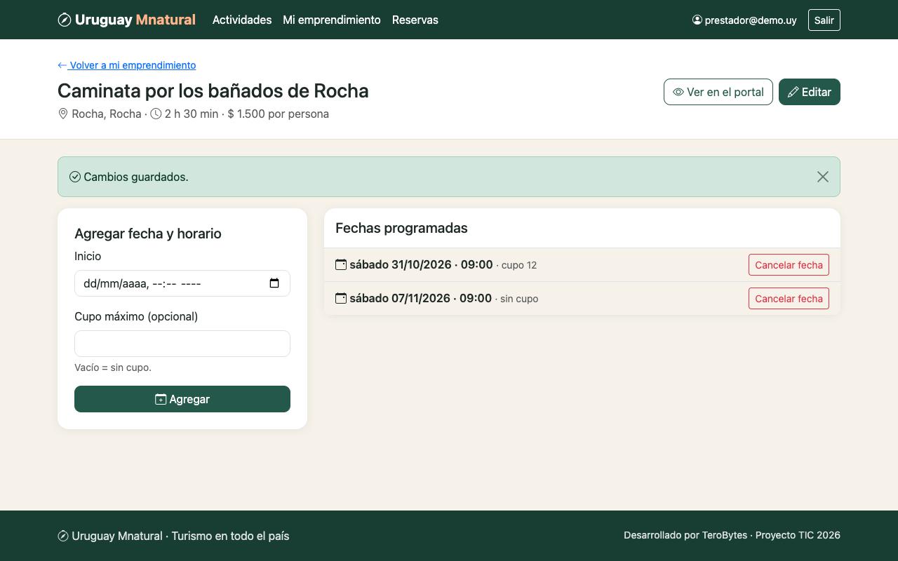

2. El sistema avisa: *"Se van a cancelar también las reservas de esta fecha. ¿Seguir?"*. Aceptá.
3. La fecha queda como **Cancelada** y **todas las reservas de esa fecha se cancelan solas**. El sistema te dice cuántas se cancelaron. Los turistas ven en su reserva que **el prestador canceló esa fecha**.

   

No se puede cancelar una fecha que ya pasó.

---

## 6. Editar una actividad

1. Entrá a la actividad con **Gestionar** y tocá **Editar**.
2. Cambiá lo que necesites (precio, descripción, equipamiento, condiciones, visible u oculta, etc.).

   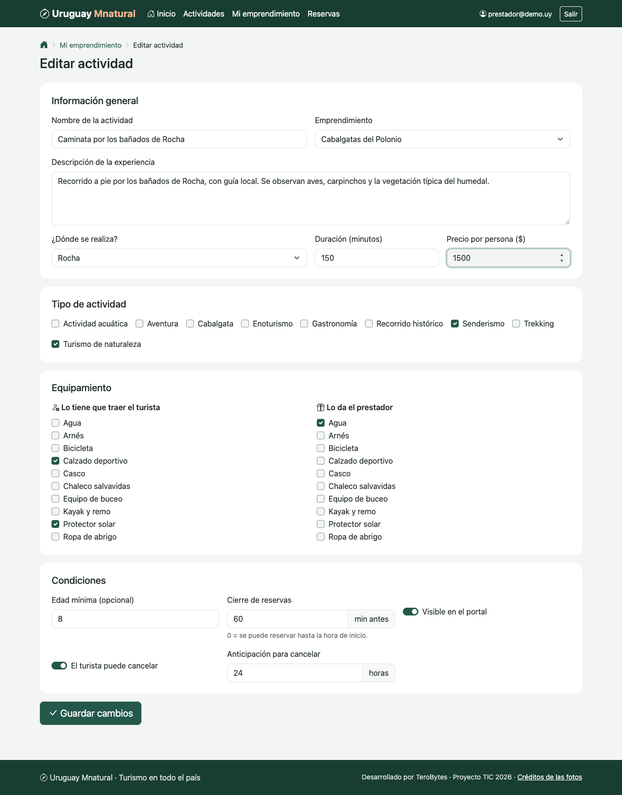

3. Tocá **Guardar cambios**. El sistema muestra *"Cambios guardados."*

Desde la misma pantalla de la actividad también podés tocar **Ver en el portal** para ver cómo la ve el turista.

Tu panel va a mostrar la actividad nueva con sus fechas.

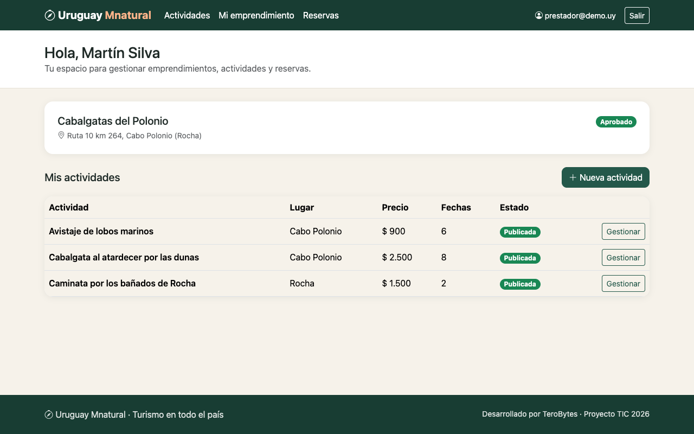

---

## 7. Ver las reservas de tus actividades

1. Tocá **Reservas** en el menú de arriba.
2. Ves una lista con todas las reservas de tus actividades. Para cada una figura:
   - **Fecha** y hora de la actividad.
   - **Actividad**.
   - **Turista**: nombre y email.
   - **Personas**: cuántas van.
   - **Observaciones**: lo que escribió el turista (alergias, condiciones médicas, etc.). Sirve para organizarte.
   - **Reserva**: el número de la reserva.
   - **Estado**: Pendiente de pago, Confirmada, Realizada o Cancelada.

   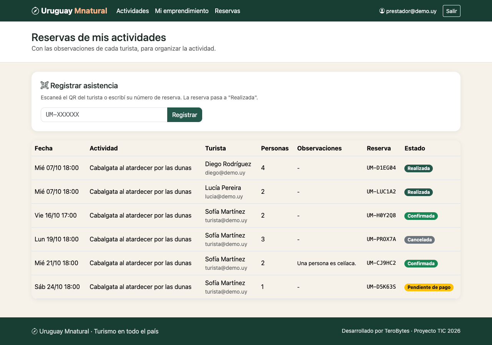

**Qué significa cada estado:**

| Estado | Qué significa |
|---|---|
| **Pendiente de pago** | El turista reservó pero todavía no pagó. Su lugar se guarda 2 horas, o hasta el cierre de reservas de esa fecha si es antes. |
| **Confirmada** | El pago está aprobado. El turista tiene su código QR. |
| **Realizada** | El turista fue y registraste su asistencia. |
| **Cancelada** | La canceló el turista, la cancelaste vos (al cancelar una fecha) o venció el plazo para pagar. |

---

## 8. Registrar la asistencia

El día de la actividad, cuando llega el turista, tenés que registrar que fue. Él te muestra su **código QR** o su **número de reserva** (por ejemplo, `UM-H0Y2Q8`).

1. Tocá **Reservas** en el menú.
2. En **Registrar asistencia**, escribí el **número de reserva** del turista.

   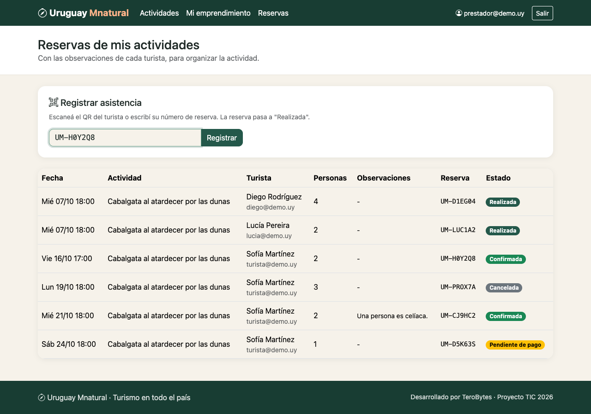

3. Tocá **Registrar**.
4. El sistema confirma con *"Asistencia registrada: [turista] ([personas]) en [actividad]."* y la reserva pasa a **Realizada**.

   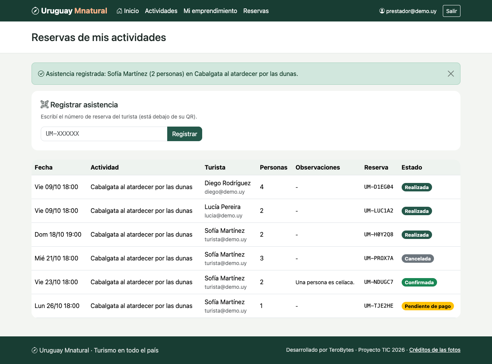

**Cuándo el sistema no la registra:**

- Si el número no existe o es de una reserva de otro prestador: *"No existe una reserva con el número …"*.

  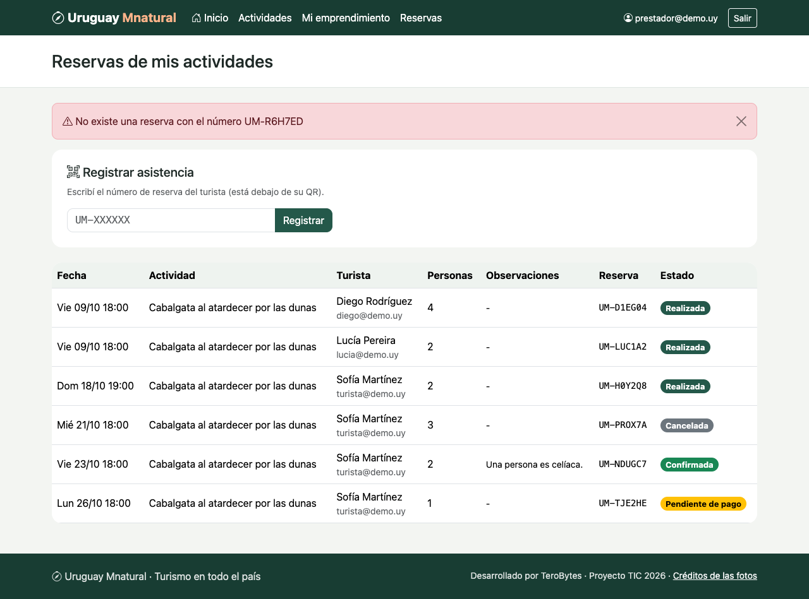

- Si la reserva ya estaba registrada: *"Esta reserva ya tenía la asistencia registrada"*.
- Si la reserva no está pagada o fue cancelada: *"La reserva no está confirmada (no fue pagada o se canceló)"*.
- Si no es el día de la actividad: *"La asistencia se registra el día de la actividad"*.

> **Por qué importa:** una vez que la reserva está **Realizada**, el turista puede **valorar** tu actividad con estrellas y un comentario. Esas valoraciones las ven los demás turistas en la página de la actividad.

---

## 9. Salir

Tocá **Salir**, arriba a la derecha, cuando termines.

---

## Preguntas frecuentes

**Mi emprendimiento figura como "Pendiente", ¿puedo cargar actividades?**
No. Primero lo tiene que aprobar un administrador de Uruguay Mnatural.

**Me rechazaron la solicitud, ¿qué hago?**
En tu panel aparece el motivo que escribió el administrador. Para volver a presentarte, consultá con Uruguay Mnatural.

**¿Cómo oculto una actividad sin borrarla?**
Editala y desactivá **Visible en el portal**. Queda como **Oculta** y los turistas no la ven.

**¿Qué pasa con las reservas si cancelo una fecha?**
Se cancelan solas todas las reservas de esa fecha.

**No quiero poner límite de personas, ¿qué hago?**
Dejá **Cupo máximo** vacío al agregar la fecha.

**¿Dónde veo lo que escribió el turista sobre alergias u otras necesidades?**
En **Reservas**, en la columna **Observaciones**.
