# Uruguay Mnatural — Manual del turista

Este manual te explica, paso a paso, cómo usar Uruguay Mnatural para encontrar una actividad turística en Uruguay, reservarla, pagarla y, después de vivirla, contarles a otros turistas cómo te fue.

**Lo que vas a poder hacer:**

1. Crear tu cuenta e ingresar.
2. Buscar actividades por destino, tipo, fecha y precio.
3. Ver el detalle de una actividad.
4. Reservar y pagar.
5. Ver tus reservas y tu código QR.
6. Cancelar una reserva.
7. Valorar una actividad.

> **Para mirar las actividades no necesitás cuenta.** La cuenta se pide recién cuando querés reservar.

---

## 1. Crear tu cuenta

1. Entrá a la página de Uruguay Mnatural. Arriba a la derecha tocá **Crear cuenta**.

   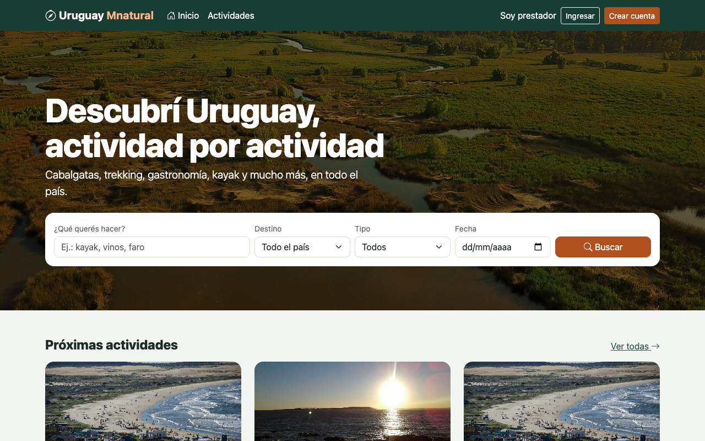

2. Completá el formulario:
   - **Nombre** y **Apellido**.
   - **Documento de identidad**.
   - **Fecha de nacimiento**. Se usa para controlar la edad mínima de las actividades que la piden.
   - **Email**. Con este email vas a ingresar.
   - **Contraseña**. Tiene que tener al menos 8 caracteres.

   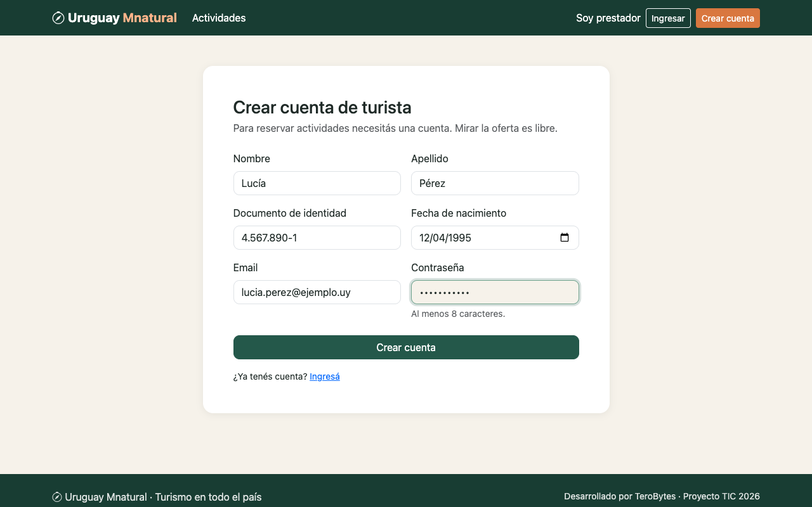

3. Tocá **Crear cuenta**.
4. Vas a ver el mensaje **"¡Listo! Ya podés ingresar con tu email y contraseña."** Ya tenés tu cuenta.

   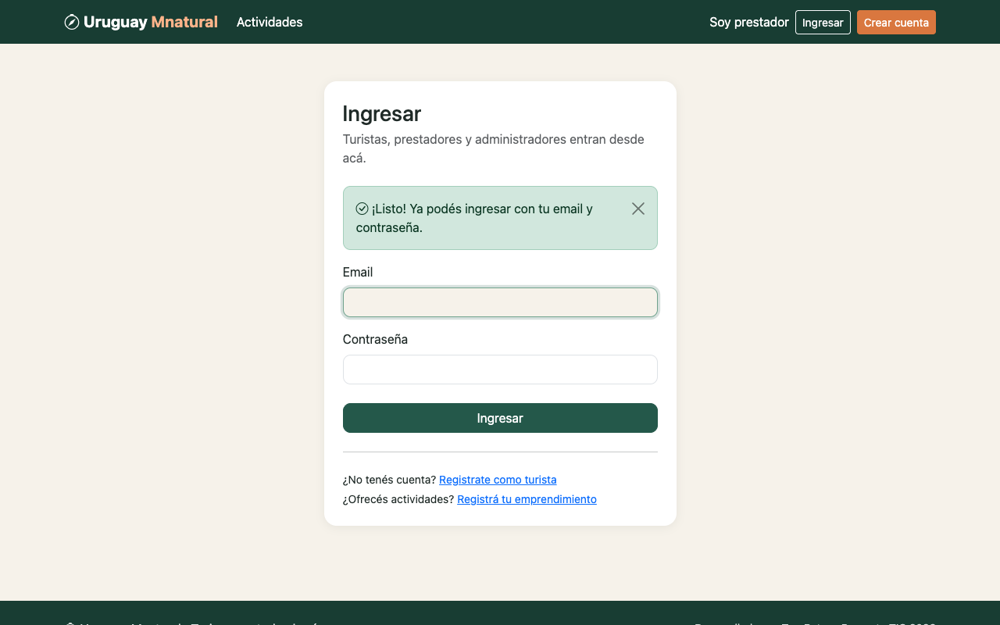

**Si algo sale mal:**
- Si el email o el documento ya están registrados, el sistema te avisa. Probá ingresar en vez de crear otra cuenta.
- Si la contraseña tiene menos de 8 caracteres o el email está mal escrito, el sistema te lo dice y no crea la cuenta.

---

## 2. Ingresar

1. Arriba a la derecha tocá **Ingresar**.
2. Escribí tu **email** y tu **contraseña**.

   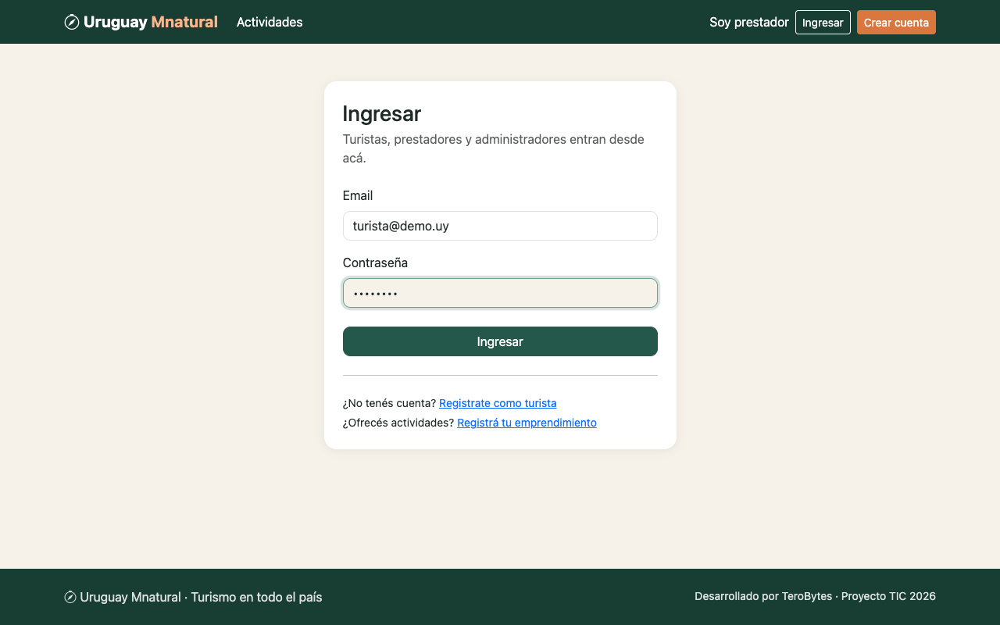

3. Tocá **Ingresar**. Arriba a la derecha vas a ver tu email: eso quiere decir que ya estás adentro. También aparece el menú **Mis reservas**.

**Si el email o la contraseña están mal**, el sistema muestra *"Email o contraseña incorrectos."*. Revisá los datos y probá de nuevo.

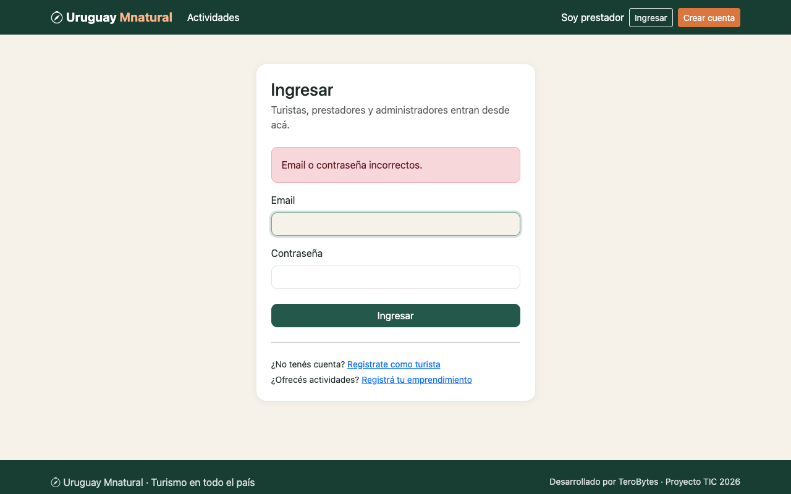

---

## 3. Buscar una actividad

### Desde la portada

1. En la portada está el buscador. Podés completar uno o varios de estos datos:
   - **¿Qué querés hacer?**: una palabra, por ejemplo *kayak*, *vinos* o *faro*.
   - **Destino**: el departamento donde querés ir.
   - **Tipo**: cabalgata, trekking, gastronomía, etc.
   - **Fecha**: el día en que querés hacer la actividad.

   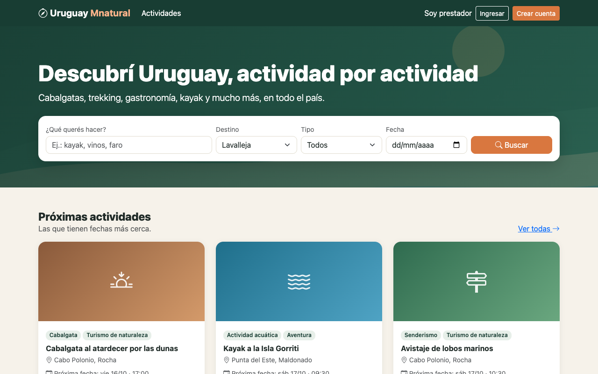

2. Tocá **Buscar**. Aparece la lista de actividades que cumplen con lo que pediste.

   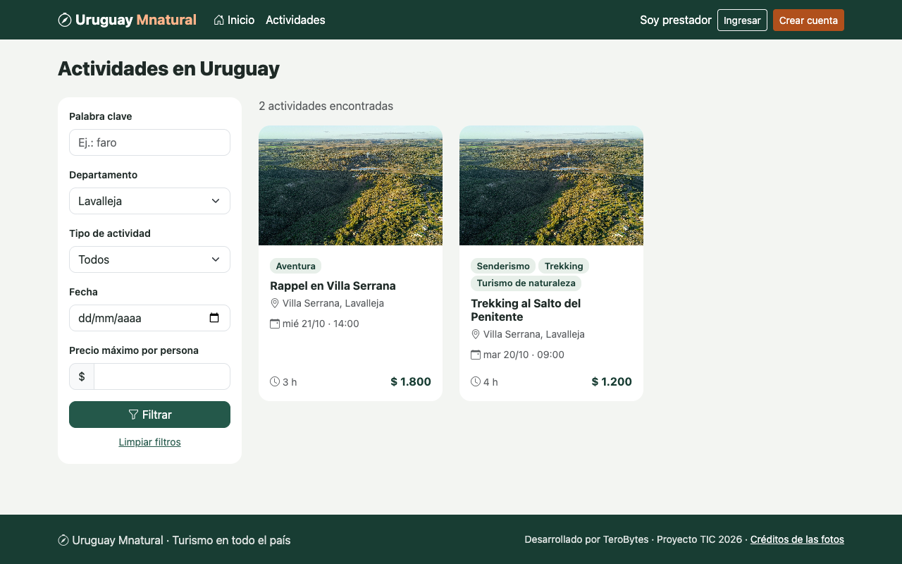

### Desde "Actividades"

1. Tocá **Actividades** en el menú de arriba. Ahí ves todas las actividades y, a la izquierda, los filtros:
   - **Palabra clave**
   - **Departamento**
   - **Tipo de actividad**
   - **Fecha**
   - **Precio máximo por persona**
2. Completá los filtros que quieras y tocá **Filtrar**.

   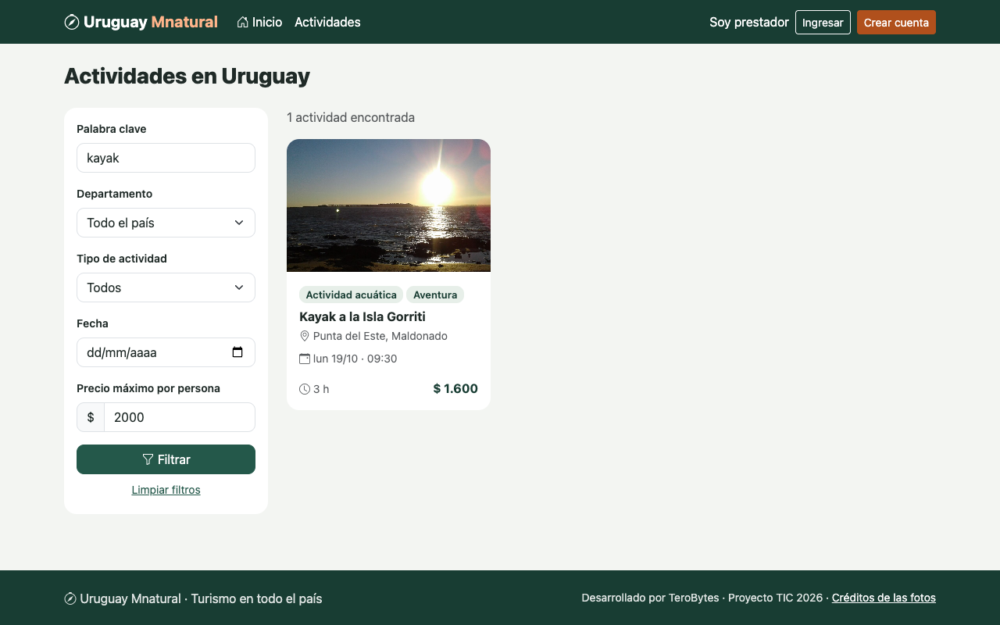

3. Para volver a ver todo, tocá **Limpiar filtros**.

Si no hay ninguna actividad con tus filtros, el sistema te lo avisa y te sugiere probar con otra fecha o destino.

---

## 4. Ver el detalle de una actividad

Tocá cualquier actividad de la lista. Vas a ver:

- La **descripción** de la experiencia y el lugar donde se hace.
- La **información útil**: cuánto dura, la edad mínima, si se puede cancelar (y con cuánta anticipación) y cuántos minutos antes cierran las reservas.
- El **equipamiento**: qué te da el prestador y qué tenés que llevar vos.
- Las **opiniones de otros turistas**, con estrellas y comentarios, y el promedio.
- El **precio por persona**.
- Las **próximas fechas**, cada una con el **pronóstico del tiempo** (temperaturas y probabilidad de lluvia). Si no hay internet, las fechas se ven igual, sin el pronóstico.

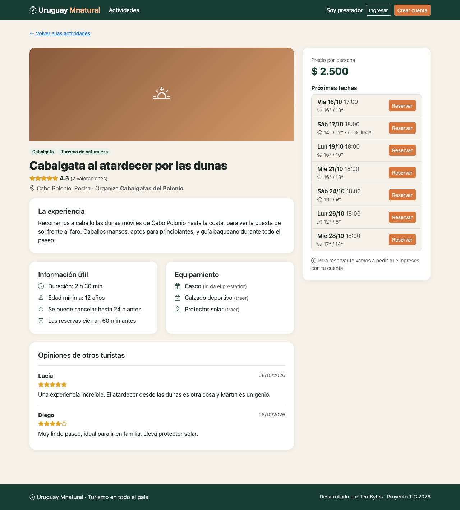

---

## 5. Reservar y pagar

### 5.1 Elegir la fecha

1. En el detalle de la actividad, en **Próximas fechas**, tocá **Reservar** en la fecha que te sirve.
2. Si todavía no ingresaste, el sistema te lleva a la pantalla de ingreso. Ingresá con tu email y contraseña y vas a volver solo a la reserva.

   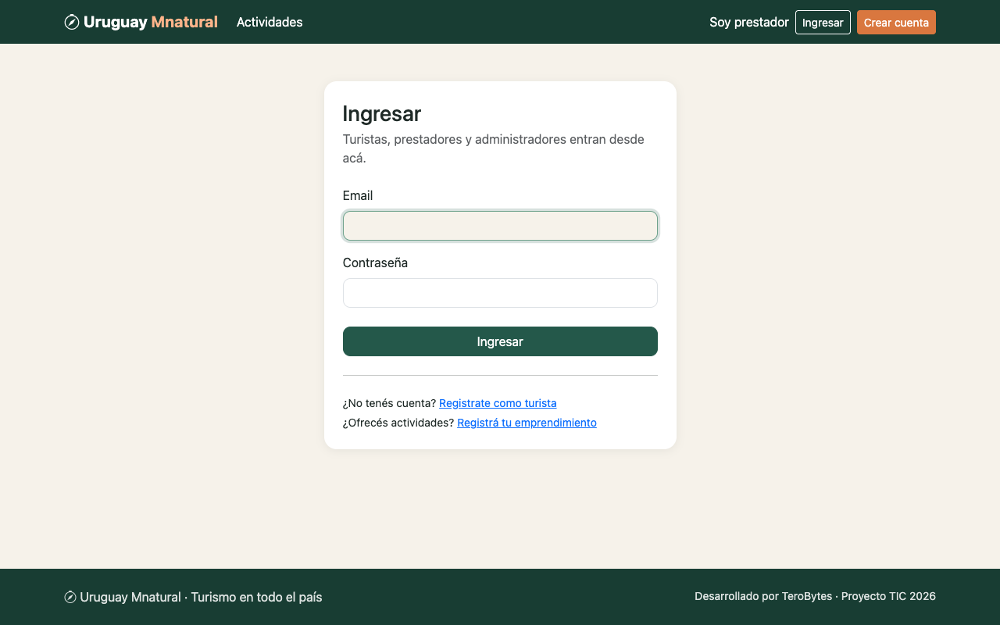

### 5.2 Completar la reserva

1. Escribí **cuántas personas van**. El **Total** se actualiza solo. Se pueden reservar hasta 20 personas por reserva.
2. Si querés, escribí una **observación para el prestador**: alergias, condiciones médicas, alguien que necesita ayuda, etc. Solo la ve el prestador y le sirve para organizar la actividad.
3. Revisá el **Total** y tocá **Continuar al pago**.

   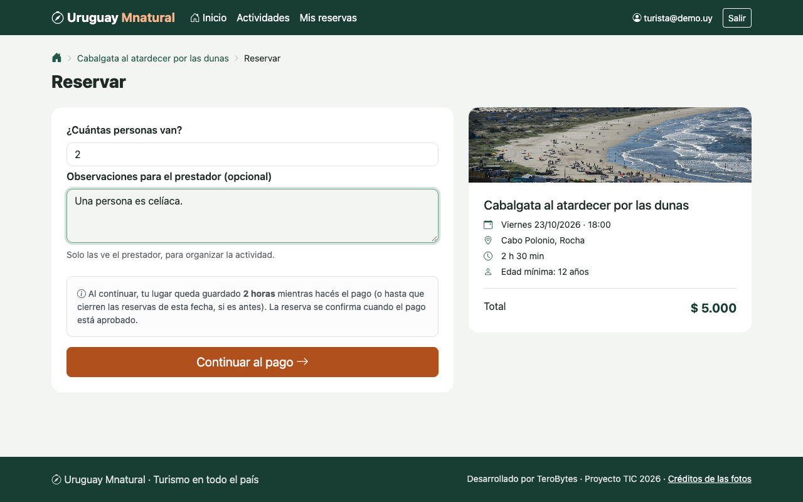

Antes de seguir, tené en cuenta:

- **Tu lugar queda guardado 2 horas** mientras hacés el pago. Si pasan las 2 horas sin pagar, la reserva se cancela sola. Si la actividad cierra sus reservas antes de esas 2 horas, el plazo para pagar termina en ese momento.
- **La reserva se confirma cuando el pago está aprobado.**
- Si la actividad tiene edad mínima y no la cumplís, el sistema no te deja reservar y te lo explica.
- Si la fecha tiene cupo y no quedan lugares, o quedan menos de los que pediste, el sistema te avisa cuántos quedan.
- Si ya cerraron las reservas para esa fecha, el sistema te lo dice.

### 5.3 Pagar

1. En **Pagar la reserva** completá los datos de tu tarjeta de crédito o débito: **número de tarjeta**, **vencimiento** y **CVV**.
2. Tocá **Pagar**.

   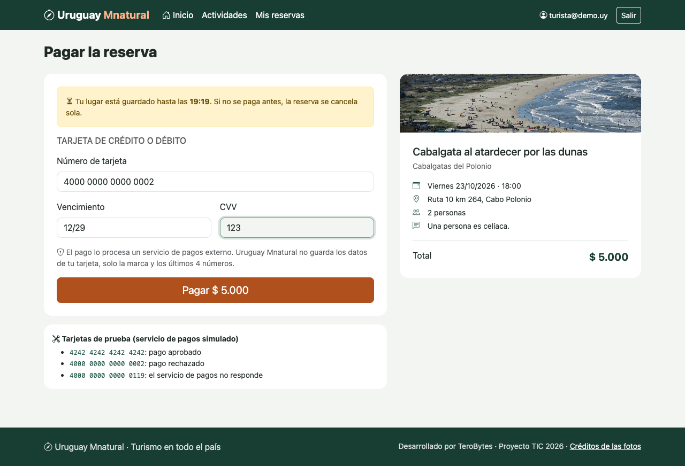

El pago lo procesa un servicio de pagos externo. Uruguay Mnatural **no guarda los datos de tu tarjeta**: solo la marca y los últimos 4 números.

> **Versión de demostración:** en la parte de abajo de la pantalla de pago hay un recuadro con **tarjetas de prueba** para ver cómo responde el sistema en cada caso. No se cobra plata de verdad.
>
> | Tarjeta | Qué pasa |
> |---|---|
> | `4242 4242 4242 4242` | El pago se aprueba y la reserva se confirma. |
> | `4000 0000 0000 0002` | El pago se rechaza. |
> | `4000 0000 0000 0119` | El servicio de pagos no responde. |

### 5.4 Qué puede pasar con el pago

**El pago se aprueba.** La reserva queda **Confirmada** y ves tu **entrada con el código QR** (ver el punto 6). Es lo que tenés que mostrar el día de la actividad.

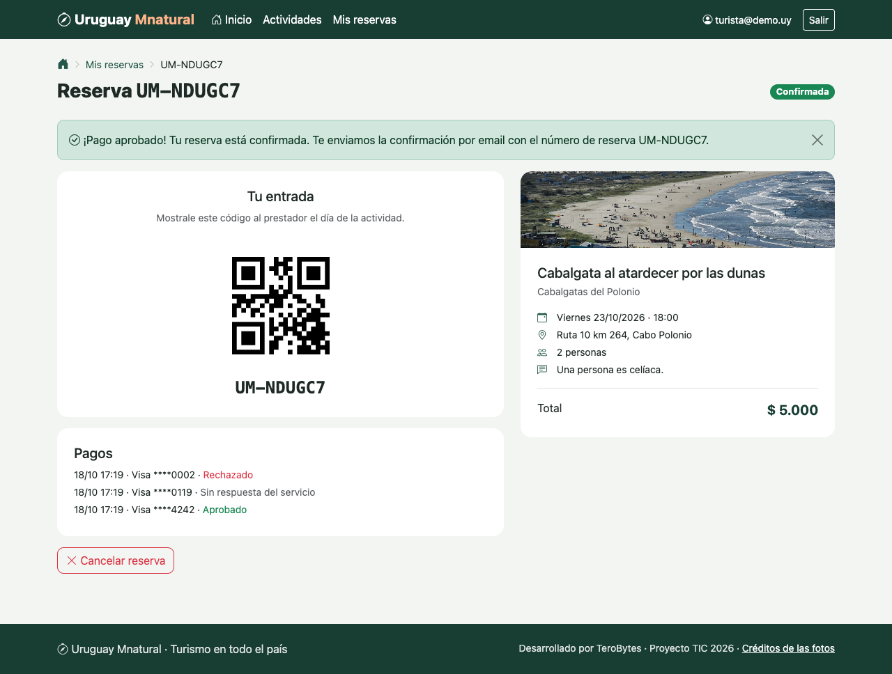

**El pago se rechaza.** El sistema te avisa el motivo (por ejemplo, fondos insuficientes). La reserva sigue pendiente y tu lugar sigue guardado hasta que se cumplan las 2 horas: podés intentar con otra tarjeta.

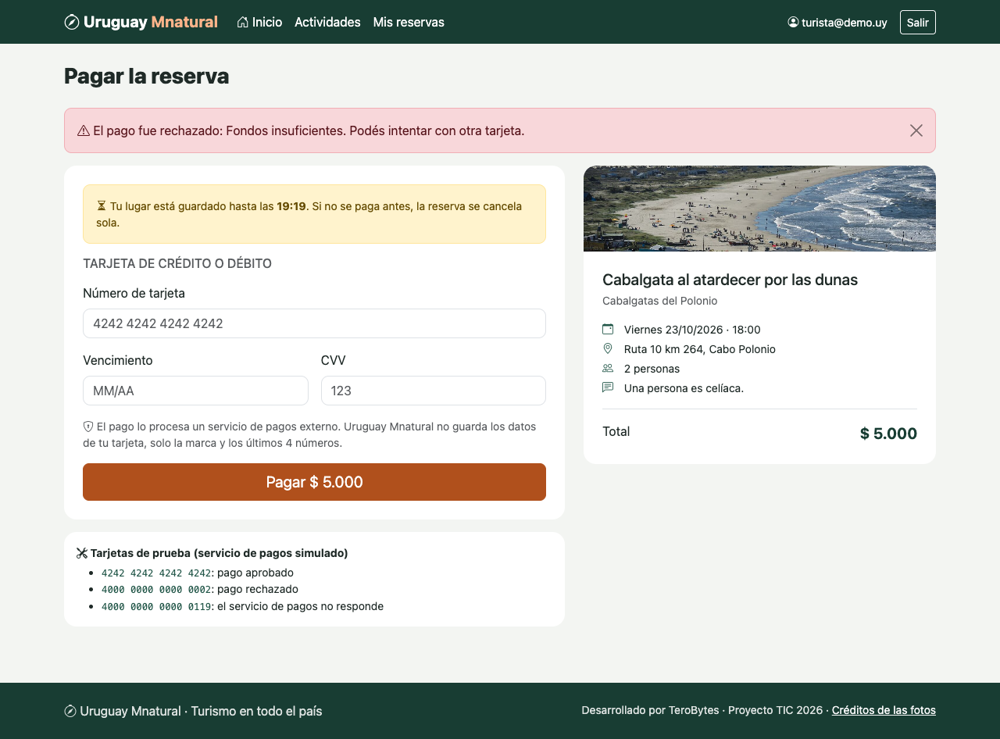

**El servicio de pagos no responde.** El sistema te avisa que no está disponible en este momento. **La reserva no se confirma.** Esperá un rato y probá de nuevo mientras tu lugar siga guardado.

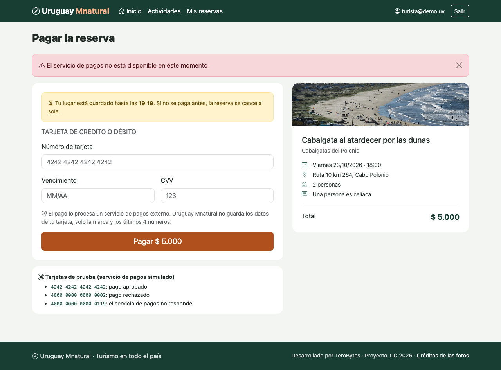

En el detalle de la reserva queda el **historial de todos tus intentos de pago**.

---

## 6. Ver tus reservas y tu código QR

1. Tocá **Mis reservas** en el menú. Ves todas tus reservas, cada una con su estado:

   | Estado | Qué significa |
   |---|---|
   | **Pendiente de pago** | Falta pagar. Tu lugar está guardado por 2 horas. |
   | **Confirmada** | Está pagada. |
   | **Realizada** | Ya participaste: el prestador registró tu asistencia. |
   | **Cancelada** | Se canceló (por vos, por el prestador o porque pasaron 2 horas sin pagar). |

   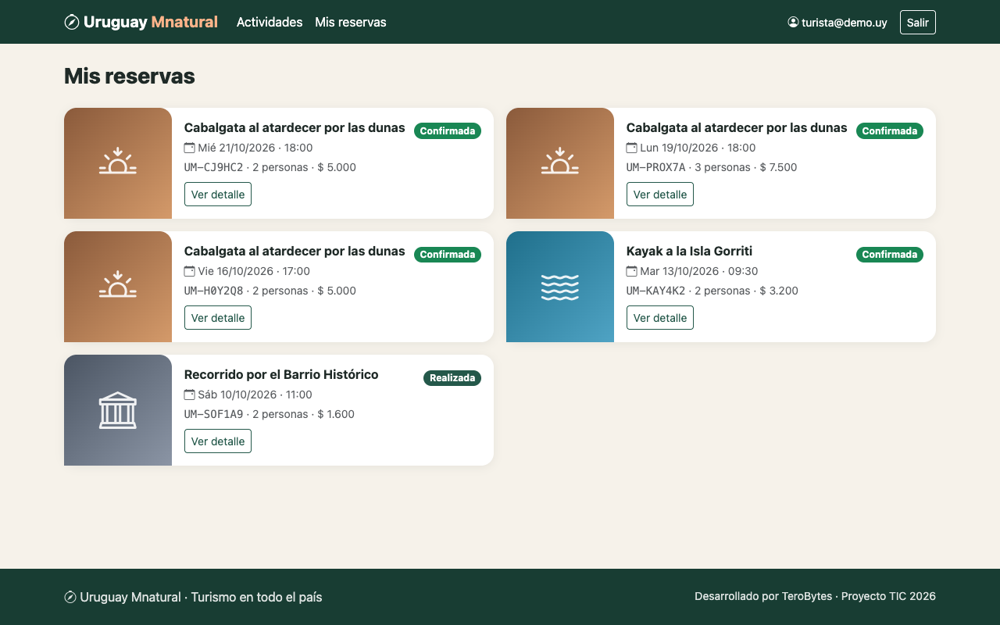

2. Tocá **Ver detalle** en cualquier reserva para ver la fecha, el lugar, la cantidad de personas, el total y el historial de pagos.
3. En las reservas **confirmadas** vas a ver tu **entrada con el código QR** y el número de reserva (por ejemplo, `UM-R6H7ED`). **El día de la actividad, mostrale ese código al prestador.** Él lo escanea o escribe el número, y así registra que fuiste.

### Si te quedó una reserva sin pagar

En **Mis reservas** la reserva aparece como **Pendiente de pago** y tiene un botón **Pagar**. Tocalo para ir a la pantalla de pago.

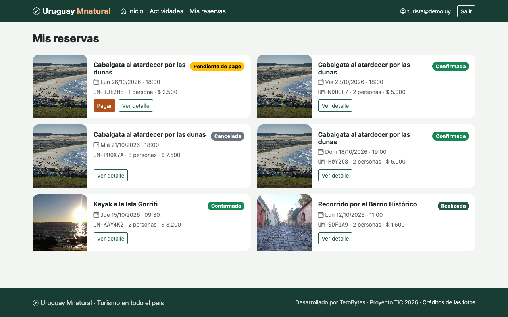

---

## 7. Cancelar una reserva

1. En **Mis reservas**, tocá **Ver detalle** de la reserva que querés cancelar.
2. Abajo tocá **Cancelar reserva**.

   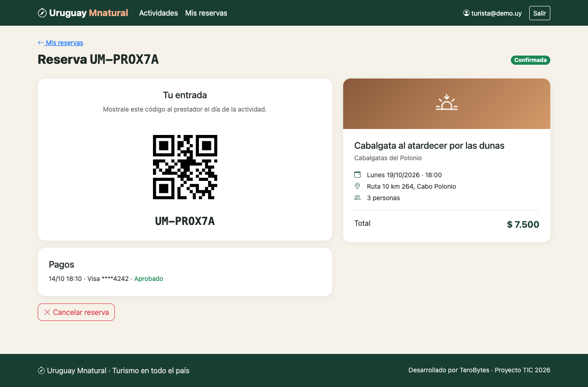

3. El sistema pregunta **"¿Seguro que querés cancelar la reserva?"**. Aceptá.
4. La reserva queda como **Cancelada**.

   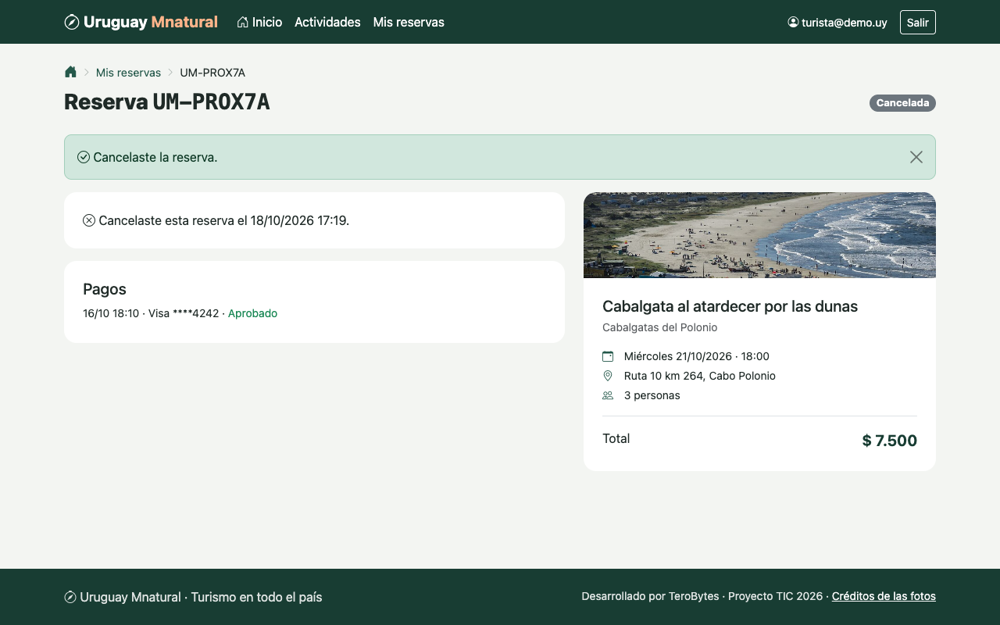

**Cuándo se puede cancelar:**

- Una reserva **pendiente de pago** se puede cancelar siempre.
- Una reserva **confirmada** se puede cancelar solo si la actividad admite cancelación **y** todavía falta más tiempo que el mínimo que fijó el prestador. Ese dato figura en el detalle de la actividad (por ejemplo, *"Se puede cancelar hasta 24 h antes"*).
- Si ya no se puede cancelar, el botón **Cancelar reserva** no aparece.

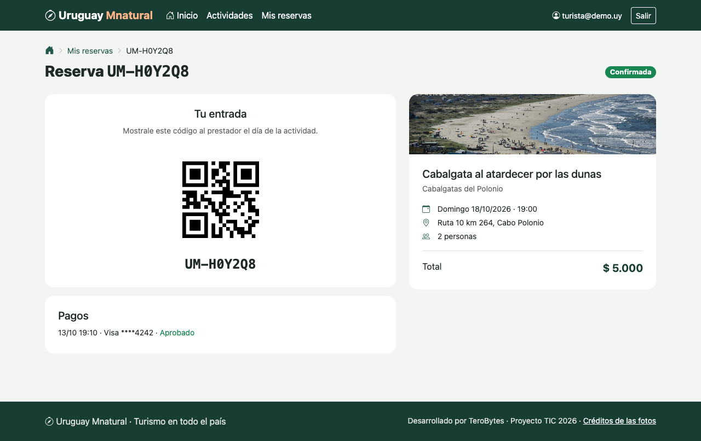

---

## 8. Valorar una actividad

Cuando la actividad ya pasó, podés contar cómo te fue.

1. Entrá a **Mis reservas** y tocá **Ver detalle** de la actividad que hiciste.
2. En **¿Qué te pareció?** elegí de **1 a 5 estrellas**.
3. Si querés, escribí un **comentario** para otros turistas.
4. Tocá **Enviar valoración**.

   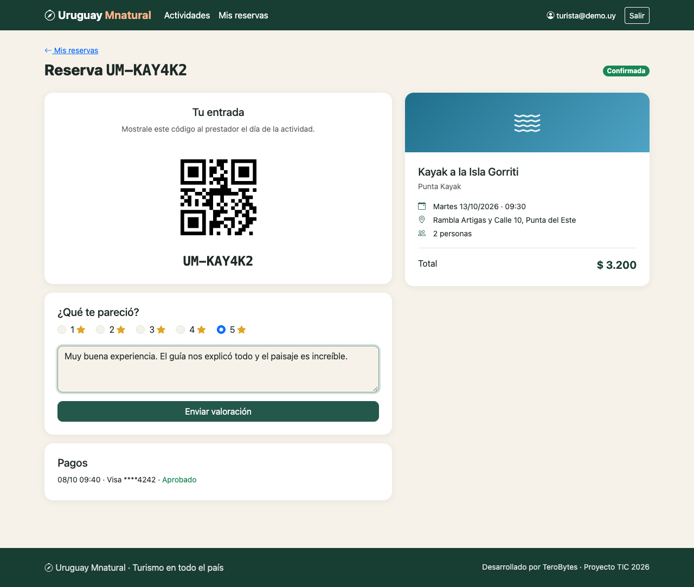

5. El sistema te agradece y tu valoración queda en el detalle de la reserva. También la van a ver otros turistas en la página de la actividad.

   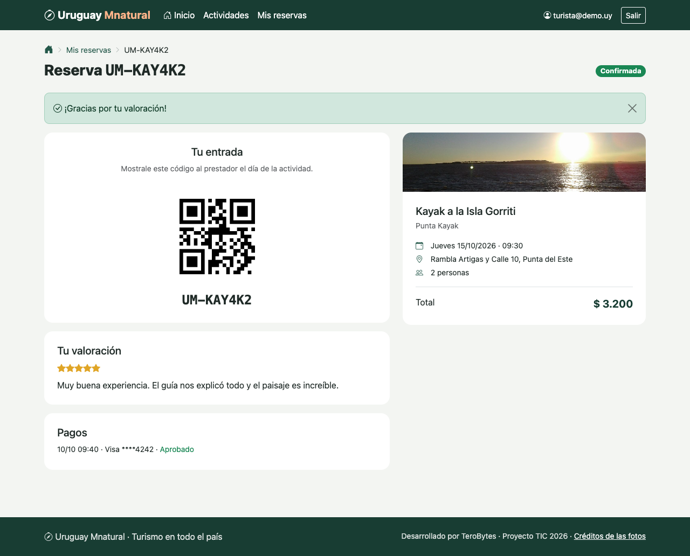

**Tené en cuenta:** solo podés valorar una actividad en la que participaste, después de que pasó, y **una sola vez**.

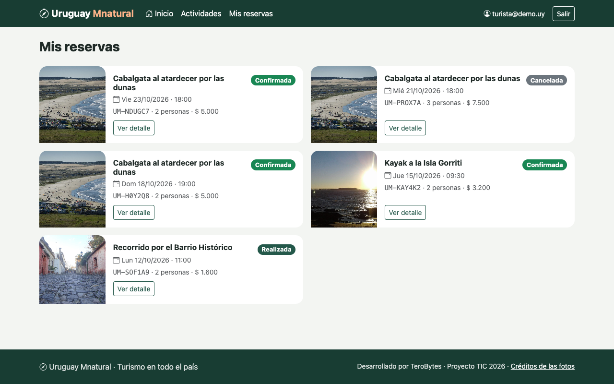

---

## 9. Salir

Cuando termines, tocá **Salir** arriba a la derecha. Vas a volver a la portada con el aviso **"Cerraste sesión."** Si usás una computadora que comparten, salí siempre.

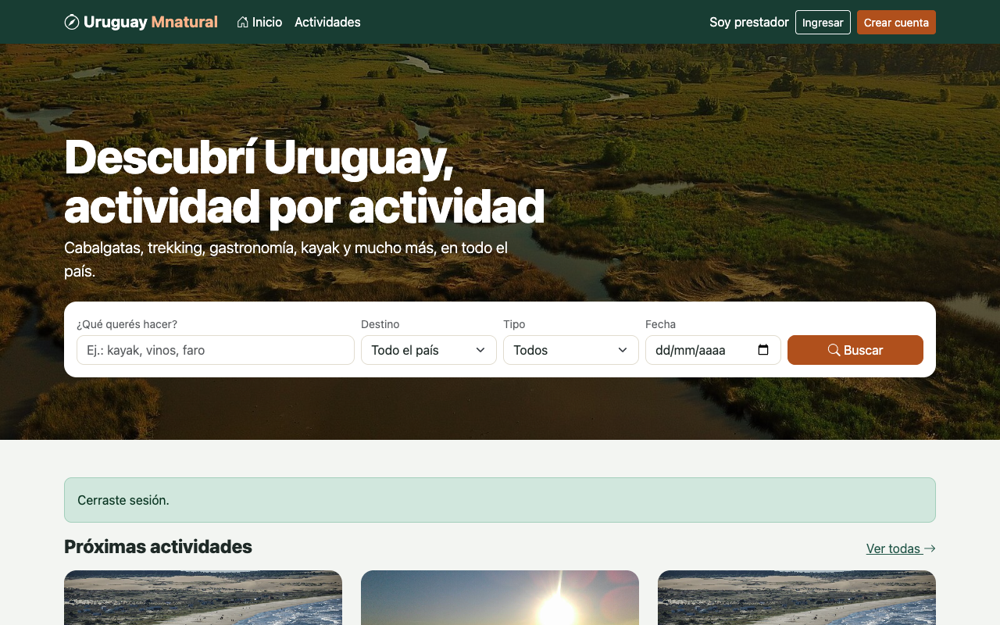

---

## Preguntas frecuentes

**¿Necesito cuenta para ver las actividades?**
No. Se puede buscar y ver todo sin cuenta. Solo se pide para reservar.

**¿Qué pasa si me olvido de pagar?**
Tu lugar se guarda 2 horas. Después la reserva se cancela sola y el lugar queda libre para otros turistas.

**El pago no funcionó, ¿qué hago?**
Si el pago se rechazó o el servicio de pagos no respondió, la reserva no se confirma y sigue como **Pendiente de pago**. Podés volver a intentarlo desde **Mis reservas → Pagar** mientras tu lugar siga guardado.

**¿Dónde veo mi código QR?**
En **Mis reservas → Ver detalle**, en las reservas confirmadas.

**¿Por qué no me aparece el botón para cancelar?**
Porque la actividad no admite cancelación o ya pasó el plazo que fijó el prestador. Si necesitás cambiar algo, comunicate con el prestador.
